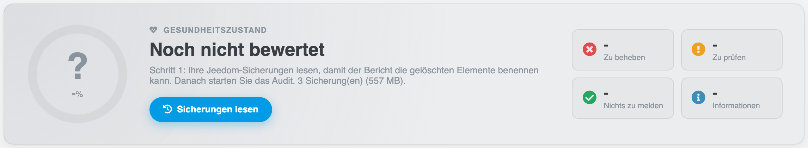
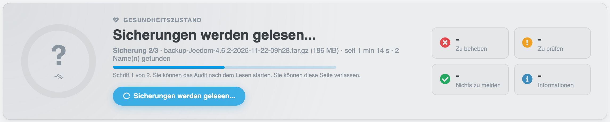
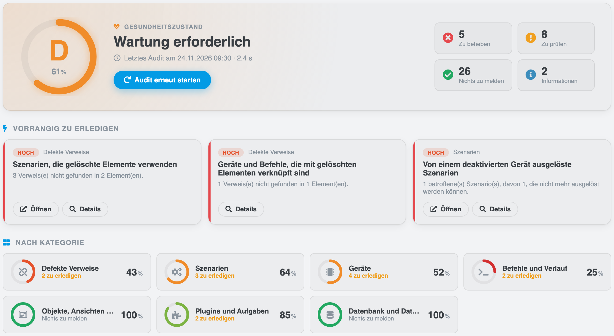
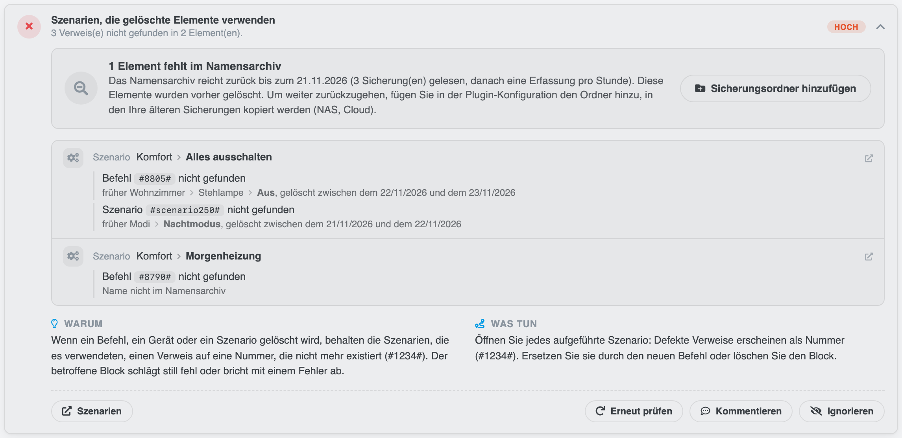
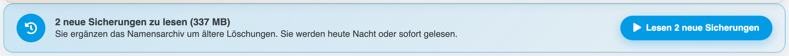
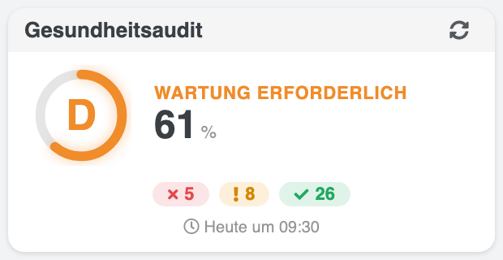

# Plugin Audit Santé

Audit Santé durchkämmt Ihre Jeedom-Installation und fasst auf einer einzigen Seite alles zusammen, was für ein Audit nötig ist: **verwaiste Elemente** (Szenarien, die nie starten, nutzlose Geräte, unbenutzte Variablen...), **defekte Verweise** auf gelöschte Elemente, **vergessene** oder **deaktivierte** Elemente und alles, was die Box **überlädt** (Verlauf, Logs, Nachrichten).

Der Schwerpunkt liegt auf dem, was Jeedom nirgends meldet: ein Szenario, das von einem deaktivierten Gerät ausgelöst wird, eine Ansicht, die einen gelöschten Befehl anzeigt, die Geräte eines deinstallierten Plugins, der Verlauf von Befehlen, die nicht mehr existieren, die geplanten Aufgaben eines entfernten Plugins...

Jedes Problem wird mit einem **Link** zu der Jeedom-Seite aufgeführt, auf der es behoben werden kann. Das Plugin vergibt außerdem eine Bewertung in Prozent mit einer Note von **A** (in Bestform) bis **F** (kritischer Zustand).

## Installation

Installieren Sie das Plugin und aktivieren Sie es. Das Gerät **Gesundheitsaudit** wird automatisch erstellt. Es sind keine Abhängigkeiten nötig.

Voraussetzung: Jeedom 4.4 oder höher.

## Ein Audit starten

Öffnen Sie *Plugins > Monitoring > Audit Santé* und klicken Sie auf **Audit starten**. Das Audit dauert je nach Größe der Installation einige Sekunden bis eine Minute. Es ändert nichts an Jeedom: Es liest die Datenbank und die Logdateien und schreibt nur seine eigenen Datendateien.

**Vor dem ersten Audit** gibt es zwei Schritte:

1. **Sicherungen lesen**: Das Plugin liest Ihre Jeedom-Sicherungen einmal, um das Namensarchiv aufzubauen (siehe unten), damit der Bericht gelöschte Elemente benennen kann. Dieses Lesen beginnt direkt nach der Installation des Plugins im Hintergrund; solange es nicht stattgefunden hat, bietet die Schaltfläche im Kopfbereich **Sicherungen lesen** an. Der Kopfbereich zeigt den Fortschritt; Sie können die Seite verlassen. Ohne Sicherung auf der Box ist es in wenigen Sekunden fertig. Die Lesedauer jeder Sicherung wird im Log und im Diagnosebericht festgehalten.
2. **Audit starten**: Sobald die Sicherungen gelesen sind, starten Sie das Audit selbst. Das Plugin startet es nie von sich aus (außer dem automatischen Audit, wenn Sie es in der Konfiguration eingestellt haben).

Der Bericht zeigt:

- die **Note** und die **Bewertung** in Prozent;
- **Vorrangig zu erledigen**: die drei wichtigsten Probleme;
- die Anzahl der Prüfungen **Zu beheben**, **Zu prüfen**, **Nichts zu melden**, die **Informationen** und die von Ihnen **Ignoriert**en;
- eine Bewertung pro Kategorie: Klicken Sie auf eine Kategorie, um ihre Prüfungen anzuzeigen;
- die Liste der Prüfungen. Standardmäßig werden nur die **Zu erledigen**den angezeigt. Klicken Sie auf eine Prüfung, um die betroffenen Elemente (jedes ist ein Link zu seiner Seite), die Bedeutung und das Vorgehen zu sehen.

## Was das Plugin prüft

Das Plugin liest die gesamte Installation einmal (Objekte, Geräte, Befehle, Szenarien mit all ihren Blöcken, Interaktionen, Ansichten, Designs, 3D-Designs, Zusammenfassungen, Konfiguration, Benutzer) und erstellt den Index « wer verwendet was ». Es erkennt die Verweise `#1234#` (Befehl), `#eqLogic12#` (Gerät), `#scenario5#` und `scenario_id` (Szenario) sowie die in Ansichten und Designs platzierten Elemente.

### Defekte Verweise

| Prüfung | Bedeutung | Was gesucht wird | Automatische Korrektur |
|---|---|---|---|
| Szenarien, die gelöschte Elemente verwenden | Hoch | Wenn ein Befehl, ein Gerät oder ein Szenario gelöscht wird, behalten die Szenarien, die es verwendeten, einen Verweis auf eine Nummer, die nicht mehr existiert (#1234#). Der betroffene Block schlägt still fehl oder bricht mit einem Fehler ab. |  |
| Geräte und Befehle, die mit gelöschten Elementen verknüpft sind | Hoch | Virtuelle Geräte, Aktionen bei Wert, Vor- und Nachausführung, verknüpfte Befehle (Schalterzustand...): Ein Gerät oder Befehl, der auf einen gelöschten Befehl verweist, funktioniert nicht mehr richtig. |  |
| Ansichten, Designs und Zusammenfassungen, die mit gelöschten Elementen verknüpft sind | Mittel | Ansichten, Designs, 3D-Designs und Objektzusammenfassungen behalten gelöschte Elemente: Sie werden leer angezeigt oder verfälschen die Zusammenfassungen (Durchschnittstemperatur, Anzahl eingeschalteter Lichter...). |  |
| Interaktionen, die mit gelöschten Elementen verknüpft sind | Mittel | Eine Interaktion, deren Antwort oder Aktionen einen gelöschten Befehl verwenden, antwortet fehlerhaft oder tut nichts mehr. |  |
| Konfiguration und Benutzer, die mit gelöschten Befehlen verknüpft sind | Mittel | Alarmbefehle (Timeout, Batterie, Gefahr...), Antwortbefehl der Interaktionen oder Benachrichtigungsbefehl eines Benutzers: Wurde er gelöscht, warnt Jeedom Sie nicht mehr. |  |

### Szenarien

| Prüfung | Bedeutung | Was gesucht wird | Automatische Korrektur |
|---|---|---|---|
| Fehlerhafte Szenarien | Hoch | Der letzte Lauf dieser Szenarien endete mit einem Fehler. Sie tun möglicherweise nicht mehr, was Sie erwarten, ohne dass Sie es bemerken. |  |
| Von einem deaktivierten Gerät ausgelöste Szenarien | Hoch | Ein deaktiviertes Gerät meldet keine Werte mehr: Die von ihm ausgelösten Szenarien starten nicht mehr. Jeedom meldet das nirgends. |  |
| Aktive Szenarien, die nie starten können | Mittel | Diese Szenarien sind aktiv, haben aber weder Auslöser noch Zeitplan, werden von keinem anderen Szenario, Gerät, keiner Interaktion, Ansicht oder keinem Design aufgerufen und werden nicht im Dashboard angezeigt. Sie starten also nie, außer manuell oder über die API. |  |
| Szenarien, die deaktivierte Elemente verwenden | Mittel | Diese aktiven Szenarien lesen oder steuern einen Befehl eines deaktivierten Geräts oder starten ein deaktiviertes Szenario: Diese Aktionen haben keine Wirkung und die Bedingungen lesen einen eingefrorenen Wert. |  |
| Szenarien, die nicht mehr laufen | Niedrig | Diese aktiven Szenarien haben einen Auslöser oder Zeitplan, sind aber seit langem (oder noch nie) gelaufen. Die Auslösebedingung tritt vielleicht nicht mehr ein: Sensor ersetzt, Modus gelöscht... |  |
| Vergessene deaktivierte Szenarien | Niedrig | Deaktivierte Szenarien, die kein anderes Element aktiviert oder startet. Sie überladen die Liste und können versehentlich wieder aktiviert werden. |  |
| Leere Szenarien | Niedrig | Szenarien ohne jeden Block: Sie laufen umsonst oder wurden erstellt und dann vergessen. |  |
| Logs der Szenarien | Niedrig | Ein Szenario mit Echtzeit-Log oder sehr gesprächig kann eine Datei von mehreren Dutzend MB erzeugen. Die Logs gelöschter Szenarien bleiben ebenfalls auf der Festplatte. | Ja |
| Jede Minute geplante Szenarien | Info | Ein jede Minute geplantes Szenario läuft 1.440 Mal am Tag. Oft erreicht ein Auslöser auf dem überwachten Befehl dasselbe, ohne die Box zu belasten. |  |

### Geräte

| Prüfung | Bedeutung | Was gesucht wird | Automatische Korrektur |
|---|---|---|---|
| Geistergeräte (Plugin entfernt oder deaktiviert) | Hoch | Wenn ein Plugin entfernt oder deaktiviert wird, bleiben seine Geräte in der Datenbank: Sie erscheinen nirgends mehr, aber die Szenarien, Ansichten und Designs, die sie verwenden, funktionieren nicht mehr. |  |
| Geräte im Timeout | Mittel | Diese Geräte haben innerhalb der konfigurierten Alarmverzögerung nicht kommuniziert: Batterie leer, Modul außer Reichweite, Gerät ausgesteckt... |  |
| Schwache Batterien | Mittel | Der Batteriestand dieser Geräte liegt unter der Alarmschwelle (Einstellungen > System > Konfiguration > Geräte oder gerätespezifische Schwelle). |  |
| Stumme Geräte | Niedrig | Aktive Geräte, deren Info-Befehle seit langem keinen Wert erhalten haben und für die keine Alarmverzögerung (Timeout) konfiguriert ist: Jeedom meldet sie daher nie. Oft sind es tote oder aus dem Haus entfernte Module. |  |
| Verwaiste Geräte | Niedrig | Aktive, aber ausgeblendete Geräte, deren Befehle weder historisiert noch anderswo verwendet werden (Szenario, anderes Gerät, Interaktion, Ansicht, Design, Zusammenfassung). Sie dienen offenbar zu nichts. Befehle, die nur in einem Code-Block eines Szenarios über ihren Namen verwendet werden, werden nicht erkannt. |  |
| Deaktivierte Geräte | Niedrig | Ein deaktiviertes Gerät meldet nichts mehr, behält aber seine Befehle, seinen Verlauf und seine Verknüpfungen. Oft entspricht es einem Gerät, das nicht mehr existiert. |  |
| Sichtbare Geräte ohne übergeordnetes Objekt | Niedrig | Ein Gerät ohne übergeordnetes Objekt erscheint auf keinem Dashboard, auch wenn « Sichtbar » angehakt ist. |  |
| Geräte ohne Befehle | Niedrig | Geräte ohne jeden Befehl: unvollendete Erstellung, fehlgeschlagene Inklusion oder Rest eines alten Geräts. |  |

### Befehle und Verlauf

| Prüfung | Bedeutung | Was gesucht wird | Automatische Korrektur |
|---|---|---|---|
| Befehle ohne Gerät | Mittel | Befehle, deren Gerät nicht mehr existiert. In der Oberfläche unsichtbar, bleiben sie mit ihrem Verlauf in der Datenbank. | Ja |
| Verlauf gelöschter Befehle | Mittel | Historisierte Werte von Befehlen, die nicht mehr existieren. Sie belegen Platz in der Datenbank und verlangsamen Sicherungen, ohne einsehbar zu sein. | Ja |
| Umfang des Verlaufs | Info | Historisierte Befehle ohne Bereinigung oder solche, die jede Sekunde einen Wert speichern, lassen die Datenbank wachsen, verlängern Sicherungen und verlangsamen Diagramme. |  |
| Unbenutzte Befehle | Info | Ausgeblendete, nicht historisierte und nirgends verwendete Befehle (Szenario, Gerät, Interaktion, Ansicht, Design, Zusammenfassung). Sie stören nicht, weisen aber oft auf aufzuräumende Geräte hin. |  |
| Befehle ohne generischen Typ | Info | Der generische Typ teilt der mobilen App, den Sprachassistenten und einigen Plugins mit, was ein Befehl tut (Licht, Steckdose, Temperatur...). Ohne ihn erscheint der Befehl dort nicht oder falsch. |  |

### Objekte, Ansichten und Designs

| Prüfung | Bedeutung | Was gesucht wird | Automatische Korrektur |
|---|---|---|---|
| Leere Objekte | Niedrig | Objekte (Räume) ohne Gerät, ohne untergeordnetes Objekt und ohne Zusammenfassung: Sie überladen das Dashboard und die Auswahllisten. |  |
| Leere Ansichten und Designs | Niedrig | Ansichten ohne Element und Designs ohne platziertes Element: unvollendete Erstellung oder Rest einer alten Organisation. |  |
| Unbenutzte benutzerdefinierte Widgets | Niedrig | Unter Werkzeuge > Widgets erstellte Widgets, die kein Befehl verwendet. |  |

### Plugins und Aufgaben

| Prüfung | Bedeutung | Was gesucht wird | Automatische Korrektur |
|---|---|---|---|
| Fehlgeschlagene Dämonen und Abhängigkeiten | Hoch | Ein Plugin, dessen Dämon angehalten ist oder dessen Abhängigkeiten nicht installiert sind, kommuniziert nicht mehr mit seinen Geräten. |  |
| Fehlerhafte geplante Aufgaben | Mittel | Fehlerhafte Aufgaben der Aufgaben-Engine (Crons des Cores und der Plugins) werden nicht mehr korrekt ausgeführt. |  |
| Verwaiste Aufgaben und Listener | Mittel | Geplante Aufgaben und Listener, die eine Klasse oder Funktion aufrufen, die nicht mehr existiert, meist die eines entfernten Plugins. Sie laufen ins Leere und füllen die Logs mit Fehlern. | Ja |
| Deaktivierte Plugins | Niedrig | Ein deaktiviertes Plugin bleibt installiert: Es belegt Platz, erscheint im Update-Center und seine Geräte werden zu Geistern. |  |
| Aktive Plugins ohne Geräte | Info | Aktivierte Plugins ohne jedes Gerät. Manche Plugins funktionieren ohne Geräte (Werkzeuge, Themes, Gateways); die anderen sind vielleicht unnötig. |  |
| Reste entfernter Plugins | Niedrig | Konfiguration und Einträge im Update-Center von Plugins, die nicht mehr installiert sind. Sie stören den Betrieb nicht, erscheinen aber wieder, wenn das Plugin neu installiert wird. |  |

### Datenbank und Dateien

| Prüfung | Bedeutung | Was gesucht wird | Automatische Korrektur |
|---|---|---|---|
| Unbenutzte Variablen | Niedrig | Szenariovariablen, die kein Szenario, Gerät und keine Interaktion liest oder schreibt. Oft sind es Reste gelöschter Szenarien. Variablen, die nur in einem Code-Block oder von einem externen Programm verwendet werden, erscheinen ebenfalls. |  |
| Variablen gelöschter Elemente | Niedrig | Variablen, die an ein nicht mehr existierendes Szenario oder Gerät gebunden sind. | Ja |
| Verwaiste Szenarioblöcke | Niedrig | Blöcke, Unterblöcke und Ausdrücke von Szenarien, die keinem Szenario mehr zugeordnet sind (Reste abgebrochener Löschungen oder Kopien). Sie belegen die Datenbank ohne Nutzen. |  |
| Größe der Datenbank | Info | Die größten Tabellen der Jeedom-Datenbank. Der Verlauf macht fast immer den Großteil aus. |  |
| Große Logdateien | Niedrig | Ein großes Log weist oft auf ein im Debug belassenes Plugin oder einen wiederkehrenden Fehler hin. Es nutzt die SD-Karte ab und füllt die Festplatte. |  |
| Nachrichtencenter | Niedrig | Dutzende unbearbeitete Nachrichten lassen wichtige Warnungen untergehen: Man liest sie nicht mehr. |  |

## Berechnung der Bewertung

Jede Prüfung hat eine Bedeutung, die ihr Gewicht in der Bewertung bestimmt:

| Bedeutung | Gewicht |
|-----------|---------|
| Hoch      | 10      |
| Mittel    | 5       |
| Niedrig   | 2       |
| Info      | 0       |

Eine Prüfung **Nichts zu melden** bringt alle ihre Punkte, eine Prüfung **Zu prüfen** die Hälfte, eine Prüfung **Zu beheben** keine. Informationen und ignorierte Prüfungen zählen nicht.

| Note | Mindestbewertung |
|------|------------------|
| A    | 90               |
| B    | 80               |
| C    | 65               |
| D    | 50               |
| E    | 35               |
| F    | 0                |

## Ein Problem beheben

Je nach Prüfung bietet das Detail:

- einen **Link** auf jedem aufgeführten Element (Szenario, Gerät, Ansicht...), der seine Seite in Jeedom öffnet;
- eine Schaltfläche zur **automatischen Korrektur** (Zauberstab-Symbol) nur für risikofreie Fälle: Löschen dessen, was nichts mehr verwenden kann (Befehle ohne Gerät, Verlauf gelöschter Befehle, Logs gelöschter Szenarien, Aufgaben und Listener eines entfernten Plugins, Variablen gelöschter Elemente). Ein Fenster erklärt vor jeder Aktion, was gelöscht wird. Erstellen Sie vorher eine Sicherung;
- **Erneut prüfen**, um nach einer manuellen Korrektur nur diese Prüfung erneut auszuführen;
- **Ignorieren**, wenn die Situation gewollt ist (ein bewusst deaktiviert gelassenes Ersatzgerät, ein von der API gestartetes Szenario...). Die Prüfung zählt nicht mehr in der Bewertung und bleibt im Filter **Ignoriert** sichtbar. Wählen Sie eine Dauer (7 Tage, 30 Tage, 3 Monate, 1 Jahr oder unbegrenzt): Danach zählt die Prüfung wieder und eine Jeedom-Nachricht weist Sie darauf hin. Sie können den Grund notieren;
- **Kommentieren**, um eine Notiz zur Prüfung zu behalten.

Das Plugin löscht nie ein Szenario, ein Gerät oder einen Befehl, der noch ein Gerät hat: Diese Entscheidungen liegen bei Ihnen.

## Den Namen eines gelöschten Elements wiederfinden

Ein defekter Verweis ist nur eine Nummer (`#1234#`, `#scenario250#`): Das Element existiert nicht mehr, sein Name auch nicht. Das Plugin führt daher ein **Namensarchiv**:

- **Stündliche Erfassung**: Der Name jedes Befehls, Geräts, Objekts und Szenarios wird festgehalten, wobei nur Änderungen geschrieben werden. Wenn ein Element verschwindet, ist sein Name bereits bekannt, mit dem Löschzeitpunkt auf die Stunde genau. Für alles, was nach der Installation des Plugins gelöscht wird, ist keine Sicherung nötig.
- **Jeedom-Sicherungen, nur einmal gelesen**: Für ältere Löschungen liest das Plugin jede Sicherung (die darin enthaltene Kopie der Datenbank) nur einmal im Hintergrund, ohne etwas auf die Festplatte zu entpacken oder zu ändern. Neue Sicherungen werden jede Nacht erkannt; die nach der Installation des Plugins erstellten werden übersprungen, die stündliche Erfassung weiß mehr.
- **Timeline**: Name der Szenarien und Befehle, die in sie schrieben.

Der gefundene Name wird neben dem Verweis mit dem Löschzeitraum angezeigt: « Befehl #999# nicht gefunden (früher [Wohnzimmer][Lampe][Zustand], gelöscht zwischen dem 10.11.2026 und dem 17.11.2026) ».

Das erste Lesen der Sicherungen ist Schritt 1 des ersten Audits (siehe « Ein Audit starten »). Danach geschieht alles in einem **Banner oben im Bericht**, dem einzigen Ort, an dem Sie auf das Archiv einwirken:

- **neue Sicherungen zu lesen** (Ordner hinzugefügt, ältere Kopien): Schaltfläche **Neue Sicherungen lesen**. Ohne Ihr Zutun werden sie in der nächsten Nacht gelesen;
- **Lesen läuft**: Fortschritt (gelesene Sicherung, Dauer, gefundene Namen). Das Lesen läuft weiter, wenn Sie die Seite verlassen; am Ende wird der bestehende Bericht um die gefundenen Namen ergänzt, ohne das Audit erneut zu starten;
- **Lesen fehlgeschlagen**: Fehlermeldung und Schaltfläche zum erneuten Starten;
- nichts zu lesen: kein Banner.

In den Prüfungen zu defekten Verweisen, Befehlen ohne Gerät und verwaistem Verlauf zeigt ein Kasten nur an, ob die Elemente ohne Namen beim nächsten Scan gesucht werden oder ob sie im Archiv fehlen (mit dem Datum, bis zu dem es zurückreicht: Sie wurden vorher gelöscht).

### Weiter in die Vergangenheit zurückgehen

Standardmäßig behält Jeedom seine Sicherungen nur wenige Tage auf der Box. Wenn Sie sie anderswo hin kopieren (NAS-Freigabe, mit der Cloud synchronisierter Ordner), binden Sie diesen Ordner auf der Box ein und fügen Sie seinen Pfad unter **Zusätzliche Sicherungsordner** hinzu (Plugin-Konfiguration). Eingebundene Netzwerkfreigaben und Ordner mit Sicherungen werden dort mit einem Klick vorgeschlagen. Die Schaltfläche **Testen** prüft, ob Jeedom den Ordner lesen kann, zählt seine Sicherungen und prüft, ob die neueste die Jeedom-Datenbank (`DB_backup.sql`) enthält. Nur `.tar.gz`-Dateien, die direkt im Ordner liegen, werden berücksichtigt. Die Sicherungen werden einmal gelesen, in der nächsten Nacht, über die Plugin-Seite oder sofort mit **Sicherungen jetzt lesen**, das auch die Ordnerliste speichert. Eine an zwei Orten vorhandene Sicherung wird nur einmal gelesen; das Datum wird aus dem Dateinamen entnommen, was zuverlässiger ist als das Datum einer Kopie.

## Wo die Daten gespeichert werden

Alle Daten des Plugins sind JSON-Dateien in `plugins/auditsante/data/`, unabhängig von der Jeedom-Datenbank:

| Datei | Inhalt |
|---|---|
| `report.json` | letzter Auditbericht |
| `ignored.json`, `comments.json` | ignorierte Prüfungen und Kommentare |
| `names.json` | Namensarchiv (ein Eintrag pro Element: Name, Anwesenheits- und Löschdaten) |
| `archive-state.json` | bereits gelesene Sicherungen, Daten der Erfassungen, Fortschritt des laufenden Lesens |

Der Ordner bleibt bei Plugin-Updates erhalten, ist in den Jeedom-Sicherungen enthalten und wird mit dem Plugin entfernt. Er ist gegen das Lesen über das Web geschützt. Schreibvorgänge sind atomar: Ein Stromausfall während des Schreibens lässt die alte Datei unversehrt. Nur die Einstellungen der Konfigurationsseite bleiben in der Jeedom-Konfiguration.

Das Löschen einer dieser Dateien ist unbedenklich: Der Bericht erscheint beim nächsten Audit wieder, das Archiv bei der nächsten Erfassung (die Sicherungen werden dann erneut gelesen).

## Gerät und Szenarien

Das Gerät **Gesundheitsaudit** trägt die folgenden Befehle, die in Ihren Szenarien verwendet werden können:

| Befehl            | Typ    | Beschreibung                                    |
|-------------------|--------|-------------------------------------------------|
| Bewertung         | info   | Bewertung in Prozent (historisiert)             |
| Note              | info   | Note von A bis F                                |
| Schwere Probleme  | info   | Anzahl der zu behebenden Prüfungen mit hoher Bedeutung |
| Zu beheben        | info   | Anzahl der zu behebenden Prüfungen              |
| Zu prüfen         | info   | Anzahl der zu prüfenden Prüfungen               |
| Letztes Audit     | info   | Datum des letzten Audits                        |
| Zusammenfassung   | info   | Einzeilige Zusammenfassung                      |
| Audit starten     | action | Startet das Audit erneut                        |

Beispiel: ein wöchentliches Szenario, das Ihnen die Zusammenfassung sendet oder Sie warnt, wenn **Schwere Probleme** über 0 steigt.

## Konfiguration

- **Automatisches Audit**: täglich, wöchentlich (standardmäßig am Montag) oder nie.
- **Bei neuen Problemen benachrichtigen**: Fügt dem Nachrichtencenter eine Nachricht hinzu, wenn eine Prüfung, die nichts meldete, ein Problem meldet.
- **Schwellenwerte**: Frist, nach der ein nicht mehr laufendes Szenario gemeldet wird (180 Tage), Frist, nach der ein stummes Gerät gemeldet wird (30 Tage), Größe eines großen Logs (20 MB), Anzahl der Nachrichten, ab der das Nachrichtencenter überladen ist (50).
- **Zusätzliche Sicherungsordner**: siehe « Weiter in die Vergangenheit zurückgehen ».

## Grenzen

- Ein Befehl, der nur in einem **Code-Block** eines Szenarios über seinen Namen verwendet wird (`cmd::byString('#[Wohnzimmer][Lampe][Zustand]#')`), wird nicht erkannt: Das Gerät kann als verwaist erscheinen und eine auf diese Weise gelesene Variable als unbenutzt.
- Ein Szenario, das nur von der **API**, einem externen Programm oder der mobilen App gestartet wird, erscheint als « kann nie starten ». Ignorieren Sie die Prüfung in diesem Fall.
- Plugins, die ihre Verknüpfungen anderswo als in der Konfiguration ihrer Geräte oder Befehle speichern, werden nicht erfasst.
- « Stummes Gerät » beruht auf dem Datum des zuletzt empfangenen Werts, das durch einen Neustart, der den Cache leert, zurückgesetzt wird.

## FAQ

**Ändert das Audit etwas?**
Nein. Nur die Schaltflächen zur automatischen Korrektur ändern die Datenbank, und immer erst nach Bestätigung.

**Warum wird ein Gerät, das ich verwende, als verwaist gemeldet?**
Es ist ausgeblendet, keiner seiner Befehle ist historisiert und das Plugin findet keinen Verweis darauf (siehe Grenzen oben). Ignorieren Sie die Prüfung oder machen Sie das Gerät sichtbar.

**Ein Problem melden**
Stellen Sie das Log des Plugins auf Debug, starten Sie das Audit erneut, klicken Sie dann auf der Plugin-Seite auf **Diagnose** und hängen Sie die Datei an Ihre Nachricht im Forum an (öffentliche Adressen, Konten und E-Mails sind darin maskiert).
