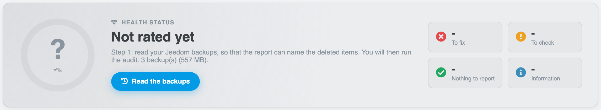
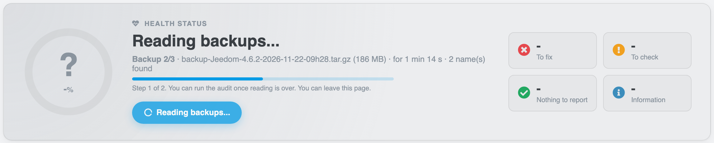
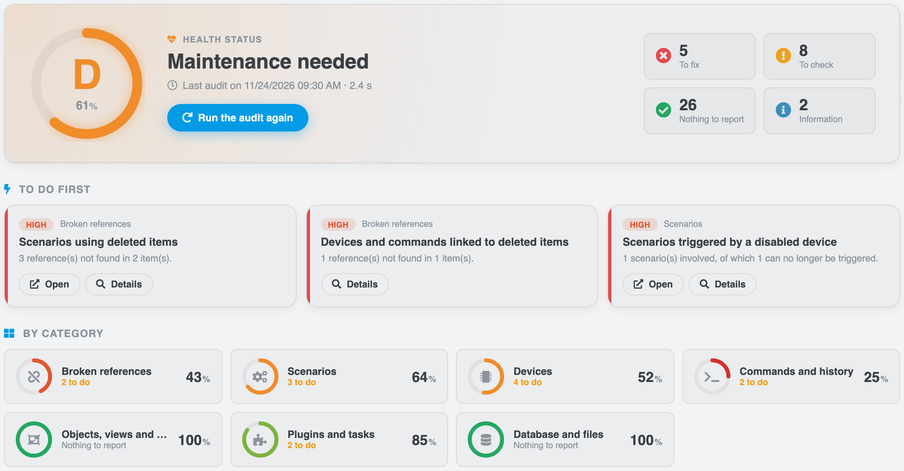
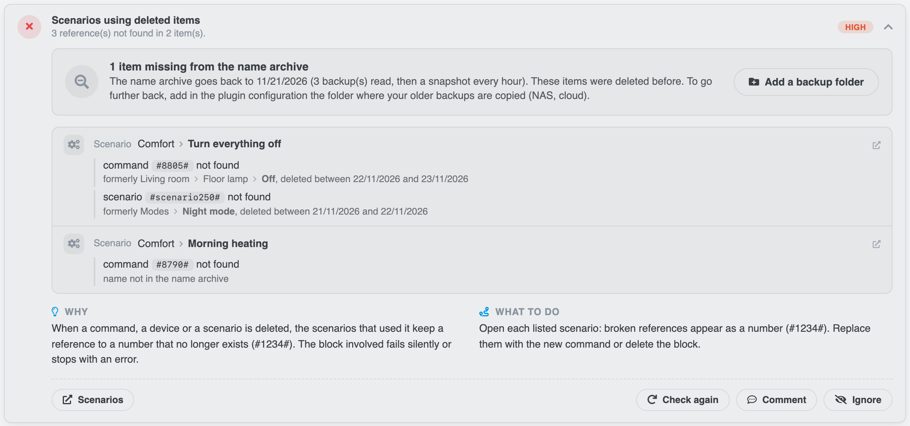
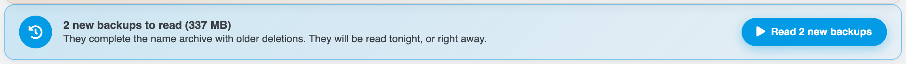
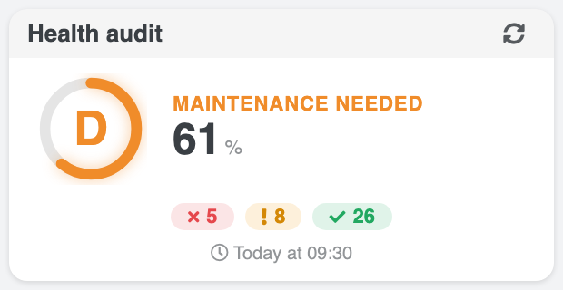

# Audit Santé plugin

Audit Santé goes through your Jeedom installation with a fine-tooth comb and gathers on a single page everything needed to audit it: **orphans** (scenarios that never run, devices that serve no purpose, unused variables...), **broken references** to deleted items, **forgotten** or **disabled** items, and what **clutters** the box (history, logs, messages).

It focuses on what Jeedom reports nowhere: a scenario triggered by a disabled device, a view showing a deleted command, the devices of an uninstalled plugin, the history of commands that no longer exist, the scheduled tasks of a removed plugin...

Each issue is listed with a **link** to the Jeedom page where you can fix it. The plugin also gives a score as a percentage, with a grade from **A** (in great shape) to **F** (critical condition).

## Installation

Install the plugin, then enable it. The **Health audit** device is created automatically. No dependency is needed.

Requirement: Jeedom 4.4 or later.

## Running an audit

Open *Plugins > Monitoring > Audit Santé* and click **Run the audit**. The audit takes from a few seconds to a minute depending on the size of the installation. It changes nothing in Jeedom: it reads the database and the log files, and only writes its own data files.

**Before the first audit**, two steps:

1. **Read the backups**: the plugin reads your Jeedom backups once to build the name archive (see below), so that the report can name deleted items. This reading starts as soon as the plugin is installed, in the background; until it has happened, the header button offers **Read the backups**. The header shows its progress; you can leave the page. Without any backup on the box, it finishes in a few seconds. The reading time of each backup is recorded in the log and in the diagnostic report.
2. **Run the audit**: once the backups are read, you run the audit yourself. The plugin never runs it on its own (except the automatic audit, if you set it in the configuration).

The report shows:

- the **grade** and the **score** as a percentage;
- **To do first**: the three most important issues;
- the number of checks **To fix**, **To check**, **Nothing to report**, the **Information** and those you have **Ignored**;
- a score per category: click a category to show its checks;
- the list of checks. By default, only those **To do** are shown. Click a check to see the items involved (each one is a link to its page), why it matters and what to do.

## What the plugin checks

The plugin reads the whole installation once (objects, devices, commands, scenarios and all their blocks, interactions, views, designs, 3D designs, summaries, configuration, users) and builds the « who uses what » index. It recognizes the references `#1234#` (command), `#eqLogic12#` (device), `#scenario5#` and `scenario_id` (scenario), as well as the items placed in views and designs.

### Broken references

| Check | Importance | What is looked for | Auto fix |
|---|---|---|---|
| Scenarios using deleted items | High | When a command, a device or a scenario is deleted, the scenarios that used it keep a reference to a number that no longer exists (#1234#). The block involved fails silently or stops with an error. |  |
| Devices and commands linked to deleted items | High | Virtual devices, actions on value, pre and post execution, linked commands (switch state...): a device or command that points to a deleted command no longer works properly. |  |
| Views, designs and summaries linked to deleted items | Medium | Views, designs, 3D designs and object summaries keep deleted items: they display empty or distort the summaries (average temperature, number of lights on...). |  |
| Interactions linked to deleted items | Medium | An interaction whose reply or actions use a deleted command replies badly or no longer does anything. |  |
| Configuration and users linked to deleted commands | Medium | Alert commands (timeout, battery, danger...), interaction reply command or a user's notification command: if it has been deleted, Jeedom no longer warns you. |  |

### Scenarios

| Check | Importance | What is looked for | Auto fix |
|---|---|---|---|
| Scenarios in error | High | The last run of these scenarios ended with an error. They may no longer do what you expect without you noticing. |  |
| Scenarios triggered by a disabled device | High | A disabled device no longer reports any value: the scenarios it triggers no longer run. Jeedom does not report it anywhere. |  |
| Active scenarios that can never run | Medium | These scenarios are active but have neither trigger nor schedule, are not called by any other scenario, device, interaction, view or design, and are not shown on the dashboard. So they never run, except manually or through the API. |  |
| Scenarios using disabled items | Medium | These active scenarios read or control a command of a disabled device, or run a disabled scenario: these actions have no effect and the conditions read a frozen value. |  |
| Scenarios that no longer run | Low | These active scenarios have a trigger or a schedule, but have not run for a long time (or ever). The trigger condition may no longer happen: sensor replaced, mode deleted... |  |
| Forgotten disabled scenarios | Low | Disabled scenarios that no other item enables or runs. They clutter the list and may be re-enabled by mistake. |  |
| Empty scenarios | Low | Scenarios without any block: they run for nothing or were created then forgotten. |  |
| Scenario logs | Low | A scenario with real-time logging or very verbose can produce a file of several tens of MB. Logs of deleted scenarios also remain on the disk. | Yes |
| Scenarios scheduled every minute | Info | A scenario scheduled every minute runs 1,440 times a day. Often, a trigger on the monitored command does the same without loading the box. |  |

### Devices

| Check | Importance | What is looked for | Auto fix |
|---|---|---|---|
| Ghost devices (plugin removed or disabled) | High | When a plugin is removed or disabled, its devices remain in the database: they no longer appear anywhere, but the scenarios, views and designs that use them no longer work. |  |
| Devices in timeout | Medium | These devices have not communicated within the configured alert delay: empty battery, module out of range, device unplugged... |  |
| Low batteries | Medium | The battery level of these devices is below the alert threshold (Settings > System > Configuration > Devices, or device-specific threshold). |  |
| Silent devices | Low | Active devices whose info commands have not received any value for a long time, and with no alert delay (timeout) configured: Jeedom never reports them. They are often dead modules or removed from the house. |  |
| Orphan devices | Low | Active but hidden devices, none of whose commands is historized or used elsewhere (scenario, other device, interaction, view, design, summary). They apparently serve no purpose. Commands used only in a code block of a scenario, by their name, are not detected. |  |
| Disabled devices | Low | A disabled device no longer reports anything but keeps its commands, history and links. Often, it matches an appliance that no longer exists. |  |
| Visible devices without a parent object | Low | A device without a parent object does not appear on any dashboard, even if « Visible » is checked. |  |
| Devices without commands | Low | Devices that have no command: unfinished creation, failed inclusion or leftover of an old appliance. |  |

### Commands and history

| Check | Importance | What is looked for | Auto fix |
|---|---|---|---|
| Commands without a device | Medium | Commands whose device no longer exists. Invisible in the interface, they remain in the database with their history. | Yes |
| History of deleted commands | Medium | Historized values of commands that no longer exist. They take up space in the database and slow down backups, without being viewable. | Yes |
| History volume | Info | Historized commands without purge, or that record a value every second, make the database grow, lengthen backups and slow down charts. |  |
| Unused commands | Info | Hidden commands, not historized and used nowhere (scenario, device, interaction, view, design, summary). They do no harm, but often point to devices that need cleaning up. |  |
| Commands without a generic type | Info | The generic type tells the mobile app, voice assistants and some plugins what a command does (light, plug, temperature...). Without it, the command does not appear there, or appears badly. |  |

### Objects, views and designs

| Check | Importance | What is looked for | Auto fix |
|---|---|---|---|
| Empty objects | Low | Objects (rooms) without devices, child objects or summary: they clutter the dashboard and selection lists. |  |
| Empty views and designs | Low | Views without any item and designs without any placed item: unfinished creation or leftover of an old organization. |  |
| Unused custom widgets | Low | Widgets created in Tools > Widgets that no command uses. |  |

### Plugins and tasks

| Check | Importance | What is looked for | Auto fix |
|---|---|---|---|
| Failed daemons and dependencies | High | A plugin whose daemon is stopped or whose dependencies are not installed no longer communicates with its devices. |  |
| Scheduled tasks in error | Medium | Tasks of the task engine (core and plugin crons) in error no longer run properly. |  |
| Orphan tasks and listeners | Medium | Scheduled tasks and listeners that call a class or function that no longer exists, usually that of a removed plugin. They run for nothing and fill the logs with errors. | Yes |
| Disabled plugins | Low | A disabled plugin remains installed: it takes up space, appears in the update center and its devices become ghosts. |  |
| Active plugins without devices | Info | Enabled plugins that have no device. Some plugins work without devices (tools, themes, gateways); the others may be useless. Plugins that do not manage devices by nature (their page shows neither a device list nor an Add button: assistants, tools, themes) are not reported; only their number is shown. |  |
| Leftovers of removed plugins | Low | Configuration and update center entries of plugins that are no longer installed. They do not affect operation but reappear if the plugin is reinstalled. |  |

### Database and files

| Check | Importance | What is looked for | Auto fix |
|---|---|---|---|
| Unused variables | Low | Scenario variables that no scenario (code blocks included), device, interaction, view or design reads or writes. They are often leftovers from deleted scenarios. Those used only by an external program (API) or by a plugin that keeps its own configuration also appear. The check covers the uses Jeedom shows in Tools > Variables, and also searches code blocks, views and designs. |  |
| Variables of deleted items | Low | Variables attached to a scenario or device that no longer exists. | Yes |
| Orphan scenario blocks | Low | Scenario blocks, sub-blocks and expressions that are no longer attached to any scenario (leftovers of interrupted deletions or copies). They take up database space for nothing. |  |
| Database size | Info | The largest tables of the Jeedom database. History almost always accounts for most of it. |  |
| Large log files | Low | A large log often points to a plugin left in Debug or a recurring error. It wears out the SD card and fills the disk. |  |
| Message center | Low | Dozens of unprocessed messages drown out important alerts: nobody reads them anymore. |  |

## How the score is calculated

Each check has an importance, which gives its weight in the score:

| Importance | Weight |
|------------|--------|
| High       | 10     |
| Medium     | 5      |
| Low        | 2      |
| Info       | 0      |

A **Nothing to report** check earns all its points, a **To check** check half, a **To fix** check none. Information and ignored checks do not count.

| Grade | Minimum score |
|-------|---------------|
| A     | 90            |
| B     | 80            |
| C     | 65            |
| D     | 50            |
| E     | 35            |
| F     | 0             |

## Fixing an issue

Depending on the check, the detail offers:

- a **link** on each listed item (scenario, device, view...), which opens its page in Jeedom;
- an **automatic fix** button (magic wand icon) only for risk-free cases: deleting what nothing can use anymore (commands without a device, history of deleted commands, logs of deleted scenarios, tasks and listeners of a removed plugin, variables of deleted items). A window explains what will be deleted before anything happens. Make a backup first;
- **Check again**, to rerun only this check after a manual fix;
- **Ignore**, if the situation is intended (a backup device kept disabled, a scenario run by the API...). The check leaves the score and stays visible in the **Ignored** filter. Choose a duration (7 days, 30 days, 3 months, 1 year or no limit): when it ends, the check counts again and a Jeedom message warns you. You can note the reason;
- **Exclude an item** (crossed-out eye icon to the right of its name, for unused variables), when you know it is used although the audit does not see it (variable read by an external program, name built in a way the audit does not recognize). The check is run again right away: the item leaves the list and the count, and moves to the **Excluded from the audit** list, where one click brings it back. Unlike **Ignore**, the rest of the check still counts in the score;
- **Comment**, to keep a note on the check.

The plugin never deletes a scenario, a device or a command that still has a device: those decisions are yours.

## Finding the name of a deleted item

A broken reference is only a number (`#1234#`, `#scenario250#`): the item no longer exists, nor does its name. So the plugin keeps a **name archive**:

- **Snapshot every hour**: the name of each command, device, object and scenario is recorded, writing only what changes. When an item disappears, its name is already known, with the deletion time to the hour. No backup is needed for what is deleted after the plugin is installed.
- **Jeedom backups, read only once**: for older deletions, the plugin reads each backup (the copy of the database it contains) only once, in the background, without extracting anything to disk or changing anything. New backups are detected every night; those made after the plugin was installed are skipped, as the hourly snapshot knows more.
- **Timeline**: name of the scenarios and commands that wrote to it.

The name found is shown next to the reference, with the deletion period: « command #999# not found (formerly [Living room][Lamp][State], deleted between 11/10/2026 and 11/17/2026) ».

The first backup reading is step 1 of the first audit (see « Running an audit »). After that, everything happens in a **banner at the top of the report**, the only place where you act on the archive:

- **new backups to read** (folder added, older copies): **Read the new backups** button. If you do nothing, they are read the next night;
- **reading in progress**: progress (backup being read, duration, names found). Reading continues if you leave the page; at the end, the existing report is completed with the names found, without running the audit again;
- **reading failed**: error message and button to run it again;
- nothing to read: no banner.

In the checks for broken references, commands without a device and orphan history, a box only tells whether the unnamed items will be looked up by the next scan, or whether they are missing from the archive (with the date it goes back to: they were deleted before).

### Going further back in time

By default, Jeedom keeps its backups on the box for only a few days. If you copy them elsewhere (NAS share, folder synchronized with the cloud), mount that folder on the box and add its path in **Additional backup folders** (plugin configuration). Mounted network shares and folders containing backups are suggested there in one click. The **Test** button checks that Jeedom can read the folder, counts its backups and checks that the most recent one does contain the Jeedom database (`DB_backup.sql`). Only `.tar.gz` files placed directly in the folder are taken into account. Backups are read once, the next night, from the plugin page, or right away with **Read backups now**, which also saves the folder list. A backup present in two places is read only once; the date is taken from the file name, more reliable than the date of a copy.

### Uploading a backup from your computer

If your old backups are on your computer, **Upload a backup** (plugin configuration) reads them without giving the box access to a folder. Choose one or more `.tar.gz`, `.tgz`, `.tar` or `.zip` files (the zip may contain the `.tar.gz` backup). Each file is sent in chunks, regardless of PHP's size limit. The plugin checks that it contains the Jeedom database, then reads it in the background and deletes it. Nothing is restored. The free space needed is checked before the upload.

The date is taken from the file name, otherwise from the database in the archive, otherwise from the file on the computer. A backup already read, or made after the plugin's first record, is refused because it would add nothing.

## Where the data is stored

All the plugin data are JSON files in `plugins/auditsante/data/`, independent of the Jeedom database:

| File | Content |
|---|---|
| `report.json` | last audit report |
| `ignored.json`, `comments.json` | ignored checks and comments |
| `excluded.json` | items excluded from a check (variables) |
| `names.json` | name archive (one entry per item: name, presence and deletion dates) |
| `archive-state.json` | backups already read, snapshot dates, progress of the current reading |
| `tmp/` | backups uploaded from the computer, until they are read (excluded from Jeedom backups) |

The folder is kept when the plugin is updated, included in Jeedom backups and removed with the plugin. It is protected against reading from the web. Writes are atomic: a power cut during a write leaves the old file intact. Only the settings of the configuration page stay in the Jeedom configuration.

Deleting one of these files is harmless: the report reappears at the next audit, the archive at the next snapshot (the backups are then read again).

## Device and scenarios

The **Health audit** device carries the following commands, usable in your scenarios:

| Command          | Type   | Description                                    |
|------------------|--------|------------------------------------------------|
| Score            | info   | Score as a percentage (historized)             |
| Grade            | info   | Grade from A to F                              |
| Serious issues   | info   | Number of high-importance checks to fix        |
| To fix           | info   | Number of checks to fix                        |
| To check         | info   | Number of checks to check                      |
| Last audit       | info   | Date of the last audit                         |
| Summary          | info   | One-line summary                               |
| Run the audit    | action | Runs the audit again                           |

Example: a weekly scenario that sends you the summary, or warns you when **Serious issues** goes above 0.

## Configuration

- **Automatic audit**: every day, every week (on Monday, by default) or never.
- **Warn about new issues**: adds a message to the message center when a check that reported nothing reports an issue.
- **Thresholds**: delay after which a scenario that no longer runs is reported (180 days), delay after which a silent device is reported (30 days), size of a large log (20 MB), number of messages above which the message center is cluttered (50).
- **Additional backup folders**: see « Going further back in time ».
- **Upload a backup**: see « Uploading a backup from your computer ».

## Limits

- A command used only in a scenario **code block**, by its name (`cmd::byString('#[Living room][Lamp][State]#')`), is not recognized: the device may appear as an orphan.
- In a **code block**, a variable is recognized if its full name appears in quotes (`getData('SL_cycle')`, or an array of names); if its name is assembled (`getData('SL_' . $name)`, `"SL_{$name}"`, `sprintf('SL_%s', $name)`, or `variable(SL_#trigger_name#)` in an action), any variable that starts or ends with the fixed part (`SL_` here, at least 3 characters) is considered used, and only their number is shown in the result. Conversely, a name in quotes that is not really used (in a comment, for example) counts as a use.
- A scenario run only by the **API**, an external program or the mobile app appears as « can never run ». Ignore the check in that case.
- Plugins that store their links elsewhere than in the configuration of their devices or commands are not seen.
- « Silent device » relies on the date of the last value received, which is reset by a restart that clears the cache.

## FAQ

**Does the audit change anything?**
No. Only the automatic fix buttons change the database, and always after confirmation.

**Why is a device I use reported as an orphan?**
It is hidden, none of its commands is historized, and the plugin finds no reference to it (see the limits above). Ignore the check or make the device visible.

**Reporting a problem**
Set the plugin log to Debug, run the audit again, then click **Diagnostic** on the plugin page and attach the file to your message on the forum (public addresses, accounts and e-mails are masked in it).
