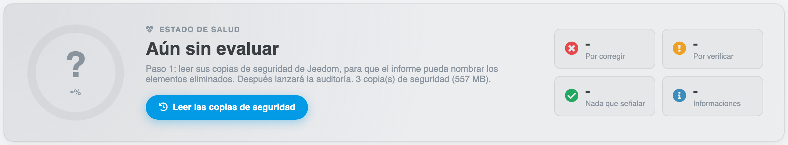
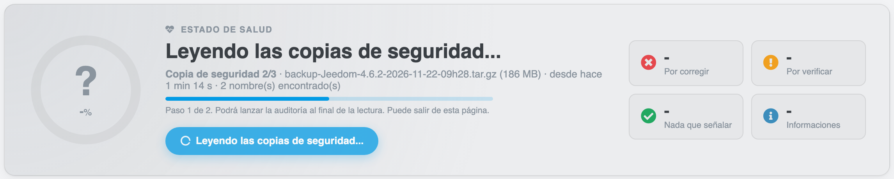
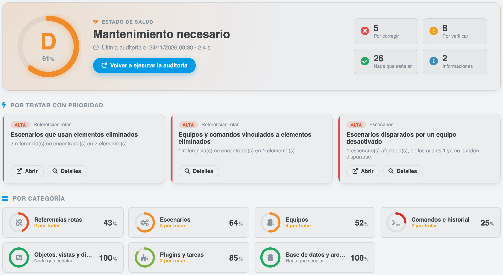
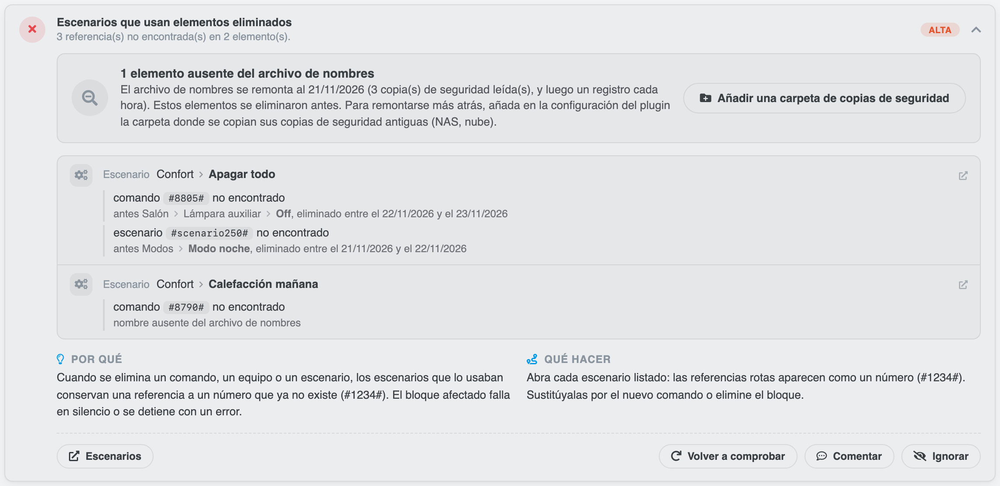
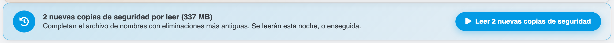
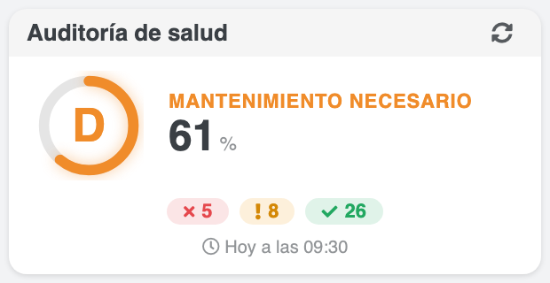

# Plugin Audit Santé

Audit Santé revisa a fondo su instalación Jeedom y reúne en una sola página todo lo necesario para auditarla: los **huérfanos** (escenarios que nunca se ejecutan, equipos que no sirven para nada, variables sin usar...), las **referencias rotas** a elementos eliminados, los elementos **olvidados** o **desactivados**, y lo que **satura** la box (historial, logs, mensajes).

Se centra en lo que Jeedom no señala en ninguna parte: un escenario disparado por un equipo desactivado, una vista que muestra un comando eliminado, los equipos de un plugin desinstalado, el historial de comandos que ya no existen, las tareas programadas de un plugin eliminado...

Cada problema aparece con un **enlace** a la página de Jeedom donde corregirlo. El plugin también da una nota en porcentaje, con una letra de **A** (en plena forma) a **F** (estado crítico).

## Instalación

Instale el plugin y actívelo. El equipo **Auditoría de salud** se crea automáticamente. No se necesita ninguna dependencia.

Requisito: Jeedom 4.4 o superior.

## Ejecutar una auditoría

Abra *Plugins > Monitoring > Audit Santé* y haga clic en **Ejecutar la auditoría**. La auditoría dura de unos segundos a un minuto según el tamaño de la instalación. No modifica nada en Jeedom: lee la base de datos y los archivos de log, y solo escribe sus propios archivos de datos.

**Antes de la primera auditoría**, dos pasos:

1. **Leer las copias de seguridad**: el plugin lee una vez sus copias de seguridad de Jeedom para construir el archivo de nombres (ver más abajo), de modo que el informe pueda nombrar los elementos eliminados. Esta lectura empieza en cuanto se instala el plugin, en segundo plano; mientras no se haya hecho, el botón de la cabecera propone **Leer las copias de seguridad**. La cabecera muestra su progreso; puede salir de la página. Sin copias de seguridad en la box, termina en unos segundos. La duración de lectura de cada copia de seguridad se anota en el log y en el informe de diagnóstico.
2. **Ejecutar la auditoría**: una vez leídas las copias de seguridad, es usted quien ejecuta la auditoría. El plugin nunca la ejecuta por su cuenta (salvo la auditoría automática, si la ha configurado).

El informe muestra:

- la **letra** y la **nota** en porcentaje;
- **Por tratar con prioridad**: los tres problemas más importantes;
- el número de comprobaciones **Por corregir**, **Por verificar**, **Nada que señalar**, las **Informaciones** y las que ha **Ignorados**;
- una nota por categoría: haga clic en una categoría para mostrar sus comprobaciones;
- la lista de comprobaciones. Por defecto, solo se muestran las **Por tratar**. Haga clic en una comprobación para ver los elementos afectados (cada uno es un enlace a su página), por qué es importante y qué hacer.

## Qué comprueba el plugin

El plugin lee una sola vez toda la instalación (objetos, equipos, comandos, escenarios y todos sus bloques, interacciones, vistas, diseños, diseños 3D, resúmenes, configuración, usuarios) y construye el índice « quién usa qué ». Reconoce las referencias `#1234#` (comando), `#eqLogic12#` (equipo), `#scenario5#` y `scenario_id` (escenario), así como los elementos colocados en las vistas y los diseños.

### Referencias rotas

| Comprobación | Importancia | Qué se busca | Corrección automática |
|---|---|---|---|
| Escenarios que usan elementos eliminados | Alta | Cuando se elimina un comando, un equipo o un escenario, los escenarios que lo usaban conservan una referencia a un número que ya no existe (#1234#). El bloque afectado falla en silencio o se detiene con un error. |  |
| Equipos y comandos vinculados a elementos eliminados | Alta | Virtuales, acciones sobre valor, pre y post ejecución, comandos vinculados (estado de un interruptor...): un equipo o comando que apunta a un comando eliminado ya no funciona correctamente. |  |
| Vistas, diseños y resúmenes vinculados a elementos eliminados | Media | Las vistas, diseños, diseños 3D y resúmenes de objetos conservan los elementos eliminados: se muestran vacíos o falsean los resúmenes (temperatura media, número de luces encendidas...). |  |
| Interacciones vinculadas a elementos eliminados | Media | Una interacción cuya respuesta o acciones usan un comando eliminado responde mal o ya no hace nada. |  |
| Configuración y usuarios vinculados a comandos eliminados | Media | Comandos de alerta (timeout, batería, peligro...), comando de respuesta de las interacciones o comando de notificación de un usuario: si se ha eliminado, Jeedom ya no le avisa. |  |

### Escenarios

| Comprobación | Importancia | Qué se busca | Corrección automática |
|---|---|---|---|
| Escenarios en error | Alta | La última ejecución de estos escenarios terminó en error. Puede que ya no hagan lo que espera sin que usted lo note. |  |
| Escenarios disparados por un equipo desactivado | Alta | Un equipo desactivado ya no envía ningún valor: los escenarios que dispara ya no se ejecutan. Jeedom no lo señala en ninguna parte. |  |
| Escenarios activos que nunca pueden ejecutarse | Media | Estos escenarios están activos pero no tienen ni disparador ni programación, no los llama ningún otro escenario, equipo, interacción, vista o diseño, y no se muestran en el dashboard. Por lo tanto nunca se ejecutan, salvo a mano o por la API. |  |
| Escenarios que usan elementos desactivados | Media | Estos escenarios activos leen o controlan un comando de un equipo desactivado, o ejecutan un escenario desactivado: estas acciones no tienen ningún efecto y las condiciones leen un valor congelado. |  |
| Escenarios que ya no se ejecutan | Baja | Estos escenarios activos tienen un disparador o una programación, pero no se ejecutan desde hace mucho tiempo (o nunca). Puede que la condición de disparo ya no ocurra: sensor sustituido, modo eliminado... |  |
| Escenarios desactivados olvidados | Baja | Escenarios desactivados que ningún otro elemento activa ni ejecuta. Saturan la lista y pueden reactivarse por error. |  |
| Escenarios vacíos | Baja | Escenarios sin ningún bloque: se ejecutan para nada o se crearon y luego se olvidaron. |  |
| Logs de los escenarios | Baja | Un escenario con log en tiempo real o muy hablador puede producir un archivo de varias decenas de MB. Los logs de los escenarios eliminados también permanecen en el disco. | Sí |
| Escenarios programados cada minuto | Info | Un escenario programado cada minuto se ejecuta 1440 veces al día. A menudo, un disparador sobre el comando vigilado hace lo mismo sin cargar la box. |  |

### Equipos

| Comprobación | Importancia | Qué se busca | Corrección automática |
|---|---|---|---|
| Equipos fantasma (plugin eliminado o desactivado) | Alta | Cuando un plugin se elimina o desactiva, sus equipos permanecen en la base: ya no aparecen en ninguna parte, pero los escenarios, vistas y diseños que los usan dejan de funcionar. |  |
| Equipos en timeout | Media | Estos equipos no se han comunicado dentro del plazo de alerta configurado: pila agotada, módulo fuera de alcance, aparato desenchufado... |  |
| Pilas bajas | Media | El nivel de pila de estos equipos está por debajo del umbral de alerta (Ajustes > Sistema > Configuración > Equipos, o umbral propio del equipo). |  |
| Equipos mudos | Baja | Equipos activos cuyos comandos info no han recibido ningún valor desde hace mucho tiempo, y sin plazo de alerta (timeout) configurado: Jeedom nunca los señala. A menudo son módulos muertos o retirados de la casa. |  |
| Equipos huérfanos | Baja | Equipos activos pero ocultos, ninguno de cuyos comandos está historizado ni se usa en otro lugar (escenario, otro equipo, interacción, vista, diseño, resumen). Aparentemente no sirven para nada. Los comandos usados solo en un bloque código de un escenario, por su nombre, no se detectan. |  |
| Equipos desactivados | Baja | Un equipo desactivado ya no envía nada pero conserva sus comandos, su historial y sus vínculos. A menudo corresponde a un aparato que ya no existe. |  |
| Equipos visibles sin objeto padre | Baja | Un equipo sin objeto padre no aparece en ningún dashboard, aunque esté marcado como « Visible ». |  |
| Equipos sin comandos | Baja | Equipos que no tienen ningún comando: creación inacabada, inclusión fallida o resto de un aparato antiguo. |  |

### Comandos e historial

| Comprobación | Importancia | Qué se busca | Corrección automática |
|---|---|---|---|
| Comandos sin equipo | Media | Comandos cuyo equipo ya no existe. Invisibles en la interfaz, permanecen en la base con su historial. | Sí |
| Historial de comandos eliminados | Media | Valores historizados de comandos que ya no existen. Ocupan espacio en la base y ralentizan las copias de seguridad, sin poder consultarse. | Sí |
| Volumen del historial | Info | Los comandos historizados sin purga, o que registran un valor cada segundo, hacen crecer la base, alargan las copias de seguridad y ralentizan los gráficos. |  |
| Comandos sin usar | Info | Comandos ocultos, no historizados y no usados en ninguna parte (escenario, equipo, interacción, vista, diseño, resumen). No molestan, pero a menudo señalan equipos que hay que limpiar. |  |
| Comandos sin tipo genérico | Info | El tipo genérico indica a la aplicación móvil, a los asistentes de voz y a algunos plugins lo que hace un comando (luz, enchufe, temperatura...). Sin él, el comando no aparece o aparece mal. |  |

### Objetos, vistas y diseños

| Comprobación | Importancia | Qué se busca | Corrección automática |
|---|---|---|---|
| Objetos vacíos | Baja | Objetos (habitaciones) sin equipo, sin objeto hijo y sin resumen: saturan el dashboard y las listas de selección. |  |
| Vistas y diseños vacíos | Baja | Vistas sin ningún elemento y diseños sin ningún elemento colocado: creación inacabada o resto de una organización antigua. |  |
| Widgets personalizados sin usar | Baja | Widgets creados en Herramientas > Widgets que ningún comando usa. |  |

### Plugins y tareas

| Comprobación | Importancia | Qué se busca | Corrección automática |
|---|---|---|---|
| Demonios y dependencias en fallo | Alta | Un plugin cuyo demonio está detenido o cuyas dependencias no están instaladas ya no se comunica con sus equipos. |  |
| Tareas programadas en error | Media | Las tareas del motor de tareas (crons del core y de los plugins) en error ya no se ejecutan correctamente. |  |
| Tareas y listeners huérfanos | Media | Tareas programadas y listeners que llaman a una clase o función que ya no existe, generalmente la de un plugin eliminado. Funcionan en vacío y llenan los logs de errores. | Sí |
| Plugins desactivados | Baja | Un plugin desactivado sigue instalado: ocupa espacio, aparece en el centro de actualizaciones y sus equipos se convierten en fantasmas. |  |
| Plugins activos sin equipos | Info | Plugins activados que no tienen ningún equipo. Algunos plugins funcionan sin equipos (herramientas, temas, pasarelas); los demás quizá sean inútiles. |  |
| Restos de plugins eliminados | Baja | Configuración y entradas del centro de actualizaciones de plugins que ya no están instalados. No afectan al funcionamiento pero reaparecen si se reinstala el plugin. |  |

### Base de datos y archivos

| Comprobación | Importancia | Qué se busca | Corrección automática |
|---|---|---|---|
| Variables sin usar | Baja | Variables de escenario que ningún escenario, equipo o interacción lee ni escribe. A menudo son restos de escenarios eliminados. Las usadas solo en un bloque código o por un programa externo también aparecen. |  |
| Variables de elementos eliminados | Baja | Variables vinculadas a un escenario o un equipo que ya no existe. | Sí |
| Bloques de escenarios huérfanos | Baja | Bloques, subbloques y expresiones de escenarios que ya no están vinculados a ningún escenario (restos de eliminaciones o copias interrumpidas). Ocupan la base sin servir. |  |
| Tamaño de la base de datos | Info | Las tablas más voluminosas de la base de Jeedom. El historial casi siempre representa la mayor parte. |  |
| Archivos de log voluminosos | Baja | Un log voluminoso suele indicar un plugin dejado en Debug o un error que se repite. Desgasta la tarjeta SD y llena el disco. |  |
| Centro de mensajes | Baja | Decenas de mensajes sin tratar ahogan las alertas importantes: ya no se leen. |  |

## Cálculo de la nota

Cada comprobación tiene una importancia, que da su peso en la nota:

| Importancia | Peso |
|-------------|------|
| Alta        | 10   |
| Media       | 5    |
| Baja        | 2    |
| Info        | 0    |

Una comprobación **Nada que señalar** suma todos sus puntos, una comprobación **Por verificar** la mitad, una comprobación **Por corregir** ninguno. Las informaciones y las comprobaciones ignoradas no cuentan.

| Letra | Nota mínima |
|-------|-------------|
| A     | 90          |
| B     | 80          |
| C     | 65          |
| D     | 50          |
| E     | 35          |
| F     | 0           |

## Corregir un problema

Según la comprobación, el detalle propone:

- un **enlace** en cada elemento listado (escenario, equipo, vista...), que abre su página en Jeedom;
- un botón de **corrección automática** (icono de varita mágica) solo para los casos sin riesgo: eliminar lo que ya nada puede usar (comandos sin equipo, historial de comandos eliminados, logs de escenarios eliminados, tareas y listeners de un plugin eliminado, variables de elementos eliminados). Una ventana explica lo que se va a eliminar antes de cualquier acción. Haga antes una copia de seguridad;
- **Volver a comprobar**, para relanzar solo esta comprobación tras una corrección manual;
- **Ignorar**, si la situación es intencionada (un equipo de reserva mantenido desactivado, un escenario ejecutado por la API...). La comprobación sale de la nota y sigue visible en el filtro **Ignorados**. Elija una duración (7 días, 30 días, 3 meses, 1 año o sin límite): al terminar, la comprobación vuelve a contar y un mensaje de Jeedom le avisa. Puede anotar el motivo;
- **Comentar**, para guardar una nota sobre la comprobación.

El plugin nunca elimina un escenario, un equipo o un comando que aún tiene un equipo: esas decisiones le corresponden.

## Recuperar el nombre de un elemento eliminado

Una referencia rota es solo un número (`#1234#`, `#scenario250#`): el elemento ya no existe, ni su nombre. Por eso el plugin mantiene un **archivo de nombres**:

- **Registro cada hora**: se anota el nombre de cada comando, equipo, objeto y escenario, escribiendo solo lo que cambia. Cuando un elemento desaparece, su nombre ya se conoce, con la hora de eliminación. No se necesita ninguna copia de seguridad para lo que se elimina después de instalar el plugin.
- **Copias de seguridad de Jeedom, leídas una sola vez**: para las eliminaciones más antiguas, el plugin lee cada copia de seguridad (la copia de la base que contiene) una sola vez, en segundo plano, sin extraer nada al disco ni modificar nada. Las nuevas copias de seguridad se detectan cada noche; las hechas después de instalar el plugin se omiten, el registro horario sabe más.
- **Timeline**: nombre de los escenarios y comandos que escribían en ella.

El nombre recuperado se muestra junto a la referencia, con el periodo de eliminación: « comando #999# no encontrado (antes [Salón][Lámpara][Estado], eliminado entre el 10/11/2026 y el 17/11/2026) ».

La primera lectura de las copias de seguridad es el paso 1 de la primera auditoría (ver « Ejecutar una auditoría »). Después, todo ocurre en un **banner en la parte superior del informe**, el único lugar donde se actúa sobre el archivo:

- **nuevas copias de seguridad por leer** (carpeta añadida, copias más antiguas): botón **Leer las nuevas copias de seguridad**. Si no hace nada, se leen la noche siguiente;
- **lectura en curso**: progreso (copia de seguridad leída, duración, nombres encontrados). La lectura continúa si sale de la página; al final, el informe existente se completa con los nombres encontrados, sin volver a ejecutar la auditoría;
- **lectura fallida**: mensaje de error y botón para relanzarla;
- nada que leer: sin banner.

En las comprobaciones de referencias rotas, comandos sin equipo e historial huérfano, un recuadro solo indica si los elementos sin nombre se buscarán en el próximo escaneo, o si están ausentes del archivo (con la fecha hasta la que se remonta: se eliminaron antes).

### Remontarse más atrás en el tiempo

Por defecto, Jeedom solo conserva sus copias de seguridad unos días en la box. Si las copia en otro lugar (recurso NAS, carpeta sincronizada con la nube), monte esa carpeta en la box y añada su ruta en **Carpetas de copias de seguridad adicionales** (configuración del plugin). Allí se proponen en un clic los recursos de red montados y las carpetas que contienen copias de seguridad. El botón **Probar** comprueba que Jeedom puede leer la carpeta, cuenta sus copias y verifica que la más reciente contiene la base de datos de Jeedom (`DB_backup.sql`). Solo se tienen en cuenta los archivos `.tar.gz` situados directamente en la carpeta. Las copias se leen una vez, la noche siguiente, desde la página del plugin o enseguida con **Leer las copias ahora**, que también guarda la lista de carpetas. Una copia de seguridad presente en dos lugares se lee una sola vez; la fecha se toma del nombre del archivo, más fiable que la fecha de una copia.

## Dónde se guardan los datos

Todos los datos del plugin son archivos JSON en `plugins/auditsante/data/`, independientes de la base de datos de Jeedom:

| Archivo | Contenido |
|---|---|
| `report.json` | último informe de auditoría |
| `ignored.json`, `comments.json` | comprobaciones ignoradas y comentarios |
| `names.json` | archivo de nombres (una entrada por elemento: nombre, fechas de presencia y de eliminación) |
| `archive-state.json` | copias de seguridad ya leídas, fechas de los registros, progreso de la lectura en curso |

La carpeta se conserva al actualizar el plugin, se incluye en las copias de seguridad de Jeedom y se elimina con el plugin. Está protegida contra la lectura desde la web. Las escrituras son atómicas: un corte de corriente durante una escritura deja intacto el archivo anterior. Solo los ajustes de la página de configuración permanecen en la configuración de Jeedom.

Eliminar uno de estos archivos no tiene riesgo: el informe reaparece en la próxima auditoría, el archivo de nombres en el próximo registro (las copias de seguridad se vuelven a leer).

## Equipo y escenarios

El equipo **Auditoría de salud** lleva los siguientes comandos, utilizables en sus escenarios:

| Comando                | Tipo   | Descripción                                    |
|------------------------|--------|------------------------------------------------|
| Nota                   | info   | Nota en porcentaje (historizada)               |
| Letra                  | info   | Letra de A a F                                 |
| Problemas graves       | info   | Número de comprobaciones de importancia alta por corregir |
| Por corregir           | info   | Número de comprobaciones por corregir          |
| Por verificar          | info   | Número de comprobaciones por verificar         |
| Última auditoría       | info   | Fecha de la última auditoría                   |
| Resumen                | info   | Resumen en una línea                           |
| Ejecutar la auditoría  | action | Vuelve a ejecutar la auditoría                 |

Ejemplo: un escenario semanal que le envía el resumen, o que le avisa cuando **Problemas graves** supera 0.

## Configuración

- **Auditoría automática**: todos los días, todas las semanas (el lunes, por defecto) o nunca.
- **Avisar de nuevos problemas**: añade un mensaje en el centro de mensajes cuando una comprobación que no señalaba nada señala un problema.
- **Umbrales**: plazo tras el cual se señala un escenario que ya no se ejecuta (180 días), plazo tras el cual se señala un equipo mudo (30 días), tamaño de un log voluminoso (20 MB), número de mensajes a partir del cual el centro de mensajes está saturado (50).
- **Carpetas de copias de seguridad adicionales**: ver « Remontarse más atrás en el tiempo ».

## Límites

- Un comando usado solo en un **bloque código** de un escenario, por su nombre (`cmd::byString('#[Salón][Lámpara][Estado]#')`), no se reconoce: el equipo puede aparecer como huérfano, y una variable leída de esa forma como sin usar.
- Un escenario ejecutado solo por la **API**, un programa externo o la aplicación móvil aparece como « que nunca puede ejecutarse ». Ignore la comprobación en ese caso.
- Los plugins que guardan sus vínculos fuera de la configuración de sus equipos o comandos no se detectan.
- « Equipo mudo » se basa en la fecha del último valor recibido, que se reinicia con un reinicio que vacía la caché.

## FAQ

**¿La auditoría modifica algo?**
No. Solo los botones de corrección automática modifican la base, y siempre tras confirmación.

**¿Por qué un equipo que uso aparece como huérfano?**
Está oculto, ninguno de sus comandos está historizado y el plugin no encuentra ninguna referencia a él (ver los límites más arriba). Ignore la comprobación o haga visible el equipo.

**Informar de un problema**
Ponga el log del plugin en Debug, vuelva a ejecutar la auditoría, haga clic en **Diagnóstico** en la página del plugin y adjunte el archivo a su mensaje en el foro (las direcciones públicas, las cuentas y los correos electrónicos están ocultos).
