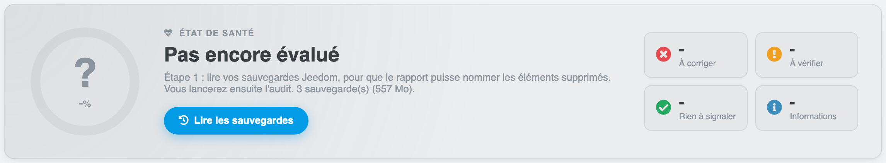
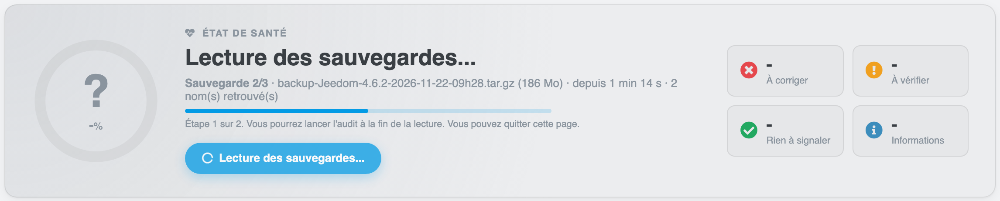
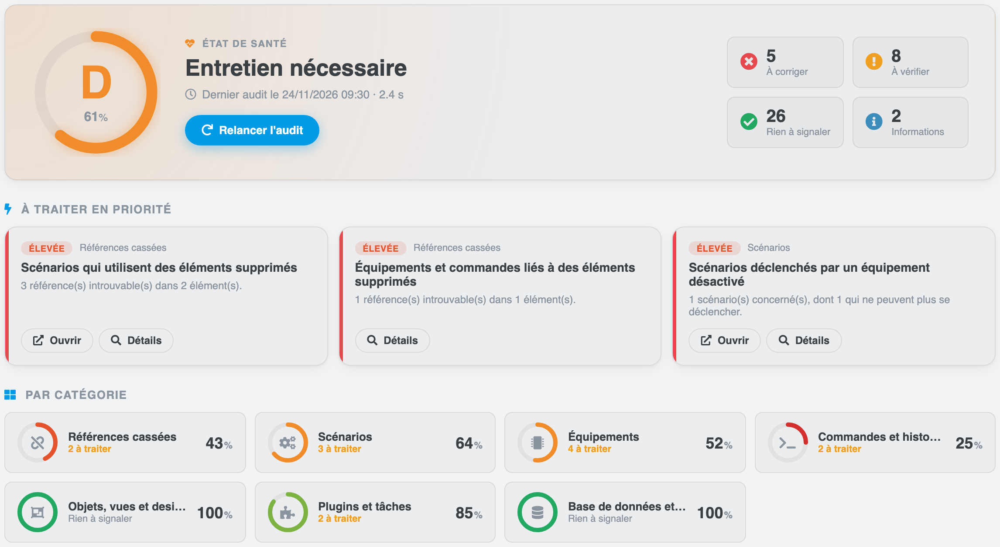
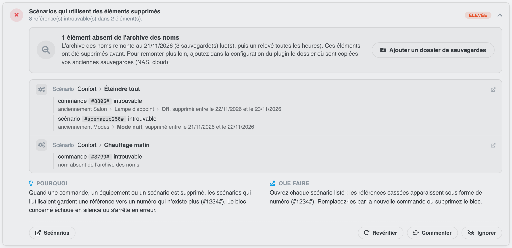
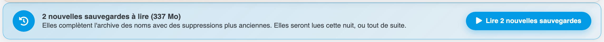
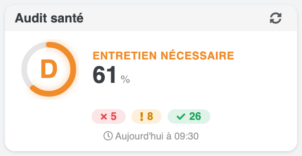

# Plugin Audit Santé

Audit Santé passe votre installation Jeedom au peigne fin et rassemble sur une seule page tout ce qu'il faut pour en faire l'audit : les **orphelins** (scénarios qui ne se lancent jamais, équipements qui ne servent à rien, variables inutilisées...), les **références cassées** vers des éléments supprimés, les éléments **oubliés** ou **désactivés**, et ce qui **encombre** la box (historique, logs, messages).

L'essentiel porte sur ce que Jeedom ne signale nulle part : un scénario déclenché par un équipement désactivé, une vue qui affiche une commande supprimée, les équipements d'un plugin désinstallé, l'historique de commandes qui n'existent plus, les tâches planifiées d'un plugin supprimé...

Chaque problème est listé avec un **lien** vers la page Jeedom où le corriger. Le plugin donne aussi une note en pourcentage, avec une lettre de **A** (en pleine forme) à **F** (état critique).

## Installation

Installez le plugin puis activez-le. L'équipement **Audit santé** est créé automatiquement. Aucune dépendance n'est nécessaire.

Prérequis : Jeedom 4.4 ou supérieur.

## Lancer un audit

Ouvrez *Plugins > Monitoring > Audit Santé* et cliquez sur **Lancer l'audit**. L'audit dure de quelques secondes à une minute selon la taille de l'installation. Il ne modifie rien dans Jeedom : il lit la base de données et les fichiers de log, et n'écrit que ses propres fichiers de données.

**Avant le premier audit**, deux étapes :

1. **Lire les sauvegardes** : le plugin lit une fois vos sauvegardes Jeedom pour constituer l'archive des noms (voir plus bas), afin que le rapport puisse nommer les éléments supprimés. Cette lecture démarre dès l'installation du plugin, en tâche de fond ; tant qu'elle n'a pas eu lieu, le bouton de l'en-tête propose **Lire les sauvegardes**. L'en-tête montre son avancement ; vous pouvez quitter la page. Sans sauvegarde sur la box, elle se termine en quelques secondes. La durée de lecture de chaque sauvegarde est notée dans le log et dans le rapport de diagnostic.
2. **Lancer l'audit** : une fois les sauvegardes lues, c'est vous qui lancez l'audit. Le plugin ne le lance jamais de lui-même (sauf l'audit automatique, si vous l'avez réglé dans la configuration).

Le rapport affiche :

- la **lettre** et la **note** en pourcentage ;
- **À traiter en priorité** : les trois problèmes les plus importants ;
- le nombre de contrôles **À corriger**, **À vérifier**, **Rien à signaler**, les **Informations** et ceux que vous avez **Ignorés** ;
- une note par catégorie : cliquez sur une catégorie pour afficher ses contrôles ;
- la liste des contrôles. Par défaut, seuls ceux **À traiter** sont affichés. Cliquez sur un contrôle pour voir les éléments concernés (chacun est un lien vers sa page), pourquoi c'est important et que faire.

## Ce que le plugin contrôle

Le plugin lit une seule fois l'ensemble de l'installation (objets, équipements, commandes, scénarios et tous leurs blocs, interactions, vues, designs, designs 3D, résumés, configuration, utilisateurs) et construit l'index « qui utilise quoi ». Il reconnaît les références `#1234#` (commande), `#eqLogic12#` (équipement), `#scenario5#` et `scenario_id` (scénario), ainsi que les éléments posés dans les vues et les designs.

### Références cassées

| Contrôle | Importance | Ce qui est recherché | Correction auto |
|---|---|---|---|
| Scénarios qui utilisent des éléments supprimés | Élevée | Quand une commande, un équipement ou un scénario est supprimé, les scénarios qui l'utilisaient gardent une référence vers un numéro qui n'existe plus (#1234#). Le bloc concerné échoue en silence ou s'arrête en erreur. |  |
| Équipements et commandes liés à des éléments supprimés | Élevée | Virtuels, actions sur valeur, pré et post exécution, commandes liées (état d'un interrupteur...) : un équipement ou une commande qui pointe vers une commande supprimée ne fonctionne plus correctement. |  |
| Vues, designs et résumés liés à des éléments supprimés | Moyenne | Les vues, designs, designs 3D et résumés d'objets gardent les éléments supprimés : ils s'affichent vides ou faussent les résumés (température moyenne, nombre de lumières allumées...). |  |
| Interactions liées à des éléments supprimés | Moyenne | Une interaction dont la réponse ou les actions utilisent une commande supprimée répond mal ou ne fait plus rien. |  |
| Configuration et utilisateurs liés à des commandes supprimées | Moyenne | Commandes d'alerte (timeout, batterie, danger...), commande de retour des interactions ou commande de notification d'un utilisateur : si elle a été supprimée, Jeedom ne vous prévient plus. |  |

### Scénarios

| Contrôle | Importance | Ce qui est recherché | Correction auto |
|---|---|---|---|
| Scénarios en erreur | Élevée | Le dernier lancement de ces scénarios s'est terminé en erreur. Ils peuvent ne plus faire ce que vous attendez sans que vous le remarquiez. |  |
| Scénarios déclenchés par un équipement désactivé | Élevée | Un équipement désactivé ne remonte plus aucune valeur : les scénarios qu'il déclenche ne se lancent plus. Jeedom ne le signale nulle part. |  |
| Scénarios actifs qui ne peuvent jamais se lancer | Moyenne | Ces scénarios sont actifs mais n'ont ni déclencheur ni programmation, ne sont appelés par aucun autre scénario, équipement, interaction, vue ou design, et ne sont pas affichés sur le dashboard. Ils ne se lancent donc jamais, sauf à la main ou par l'API. |  |
| Scénarios qui utilisent des éléments désactivés | Moyenne | Ces scénarios actifs lisent ou pilotent la commande d'un équipement désactivé, ou lancent un scénario désactivé : ces actions n'ont aucun effet et les conditions lisent une valeur figée. |  |
| Scénarios qui ne se lancent plus | Faible | Ces scénarios actifs ont un déclencheur ou une programmation, mais ne se sont pas lancés depuis longtemps (ou jamais). La condition de déclenchement n'arrive peut-être plus : capteur remplacé, mode supprimé... |  |
| Scénarios désactivés oubliés | Faible | Scénarios désactivés et qu'aucun autre élément n'active ni ne lance. Ils encombrent la liste et peuvent être réactivés par erreur. |  |
| Scénarios vides | Faible | Scénarios sans aucun bloc : ils se lancent pour rien ou ont été créés puis oubliés. |  |
| Logs des scénarios | Faible | Un scénario en log temps réel ou très bavard peut produire un fichier de plusieurs dizaines de Mo. Les logs des scénarios supprimés restent aussi sur le disque. | Oui |
| Scénarios programmés toutes les minutes | Info | Un scénario programmé toutes les minutes se lance 1 440 fois par jour. Souvent, un déclencheur sur la commande surveillée fait la même chose sans charger la box. |  |

### Équipements

| Contrôle | Importance | Ce qui est recherché | Correction auto |
|---|---|---|---|
| Équipements fantômes (plugin supprimé ou désactivé) | Élevée | Quand un plugin est supprimé ou désactivé, ses équipements restent dans la base : ils n'apparaissent plus nulle part, mais les scénarios, vues et designs qui les utilisent ne fonctionnent plus. |  |
| Équipements en timeout | Moyenne | Ces équipements n'ont pas communiqué dans le délai d'alerte configuré : pile vide, module hors de portée, appareil débranché... |  |
| Piles faibles | Moyenne | Le niveau de pile de ces équipements est sous le seuil d'alerte (Réglages > Système > Configuration > Équipements, ou seuil propre à l'équipement). |  |
| Équipements muets | Faible | Équipements actifs dont aucune commande info n'a reçu de valeur depuis longtemps, et sans délai d'alerte (timeout) configuré : Jeedom ne les signale donc jamais. Ce sont souvent des modules morts ou retirés de la maison. |  |
| Équipements orphelins | Faible | Équipements actifs mais masqués, dont aucune commande n'est historisée ni utilisée ailleurs (scénario, autre équipement, interaction, vue, design, résumé). Ils ne servent visiblement à rien. Les commandes utilisées seulement dans un bloc code d'un scénario, par leur nom, ne sont pas détectées. |  |
| Équipements désactivés | Faible | Un équipement désactivé ne remonte plus rien mais garde ses commandes, son historique et ses liens. Souvent, il correspond à un appareil qui n'existe plus. |  |
| Équipements visibles sans objet parent | Faible | Un équipement sans objet parent n'apparaît sur aucun dashboard, même s'il est coché « Visible ». |  |
| Équipements sans commande | Faible | Équipements qui n'ont aucune commande : création inachevée, inclusion ratée ou reste d'un ancien appareil. |  |

### Commandes et historique

| Contrôle | Importance | Ce qui est recherché | Correction auto |
|---|---|---|---|
| Commandes sans équipement | Moyenne | Commandes dont l'équipement n'existe plus. Invisibles dans l'interface, elles restent dans la base avec leur historique. | Oui |
| Historique de commandes supprimées | Moyenne | Valeurs historisées de commandes qui n'existent plus. Elles occupent de la place dans la base et ralentissent les sauvegardes, sans être consultables. | Oui |
| Volume de l'historique | Info | Les commandes historisées sans purge, ou qui enregistrent une valeur toutes les secondes, font grossir la base, allongent les sauvegardes et ralentissent les graphiques. |  |
| Commandes inutilisées | Info | Commandes masquées, non historisées et utilisées nulle part (scénario, équipement, interaction, vue, design, résumé). Elles ne gênent pas, mais signalent souvent des équipements à faire le ménage. |  |
| Commandes sans type générique | Info | Le type générique indique à l'application mobile, aux assistants vocaux et à certains plugins ce que fait une commande (lumière, prise, température...). Sans lui, la commande n'y apparaît pas ou mal. |  |

### Objets, vues et designs

| Contrôle | Importance | Ce qui est recherché | Correction auto |
|---|---|---|---|
| Objets vides | Faible | Objets (pièces) sans équipement, sans objet enfant et sans résumé : ils encombrent le dashboard et les listes de choix. |  |
| Vues et designs vides | Faible | Vues sans aucun élément et designs sans aucun élément posé : création inachevée ou reste d'une ancienne organisation. |  |
| Widgets personnalisés inutilisés | Faible | Widgets créés dans Outils > Widgets qu'aucune commande n'utilise. |  |

### Plugins et tâches

| Contrôle | Importance | Ce qui est recherché | Correction auto |
|---|---|---|---|
| Démons et dépendances en échec | Élevée | Un plugin dont le démon est arrêté ou dont les dépendances ne sont pas installées ne communique plus avec ses équipements. |  |
| Tâches planifiées en erreur | Moyenne | Les tâches du moteur de tâches (crons du core et des plugins) en erreur ne s'exécutent plus correctement. |  |
| Tâches et écouteurs orphelins | Moyenne | Tâches planifiées et écouteurs (listeners) qui appellent une classe ou une fonction qui n'existe plus, en général celle d'un plugin supprimé. Ils tournent dans le vide et remplissent les logs d'erreurs. | Oui |
| Plugins désactivés | Faible | Un plugin désactivé reste installé : il occupe de la place, apparaît dans le centre de mises à jour et ses équipements deviennent des fantômes. |  |
| Plugins actifs sans équipement | Info | Plugins activés qui n'ont aucun équipement. Certains plugins fonctionnent sans équipement (outils, thèmes, passerelles) ; les autres sont peut-être inutiles. |  |
| Restes de plugins supprimés | Faible | Configuration et entrées du centre de mises à jour de plugins qui ne sont plus installés. Elles ne gênent pas le fonctionnement mais réapparaissent si le plugin est réinstallé. |  |

### Base de données et fichiers

| Contrôle | Importance | Ce qui est recherché | Correction auto |
|---|---|---|---|
| Variables inutilisées | Faible | Variables de scénario qu'aucun scénario, équipement ou interaction ne lit ni n'écrit. Ce sont souvent des restes de scénarios supprimés. Celles utilisées seulement dans un bloc code ou par un programme externe apparaissent aussi. |  |
| Variables d'éléments supprimés | Faible | Variables rattachées à un scénario ou un équipement qui n'existe plus. | Oui |
| Blocs de scénarios orphelins | Faible | Blocs, sous-blocs et expressions de scénarios qui ne sont plus rattachés à aucun scénario (restes de suppressions ou de copies interrompues). Ils occupent la base sans servir. |  |
| Taille de la base de données | Info | Les tables les plus volumineuses de la base Jeedom. L'historique en représente presque toujours l'essentiel. |  |
| Fichiers de log volumineux | Faible | Un log volumineux signale souvent un plugin resté en Debug ou une erreur qui se répète. Il use la carte SD et remplit le disque. |  |
| Centre de messages | Faible | Des dizaines de messages non traités noient les alertes importantes : on ne les lit plus. |  |

## Calcul de la note

Chaque contrôle a une importance, qui donne son poids dans la note :

| Importance | Poids |
|------------|-------|
| Élevée     | 10    |
| Moyenne    | 5     |
| Faible     | 2     |
| Info       | 0     |

Un contrôle **Rien à signaler** rapporte tous ses points, un contrôle **À vérifier** la moitié, un contrôle **À corriger** aucun. Les informations et les contrôles ignorés ne comptent pas.

| Lettre | Note minimale |
|--------|---------------|
| A      | 90            |
| B      | 80            |
| C      | 65            |
| D      | 50            |
| E      | 35            |
| F      | 0             |

## Corriger un problème

Selon le contrôle, le détail propose :

- un **lien** sur chaque élément listé (scénario, équipement, vue...), qui ouvre sa page dans Jeedom ;
- un bouton de **correction automatique** (icône baguette magique) pour les seuls cas sans risque : supprimer ce que plus rien ne peut utiliser (commandes sans équipement, historique de commandes supprimées, logs de scénarios supprimés, tâches et écouteurs d'un plugin supprimé, variables d'éléments supprimés). Une fenêtre explique ce qui va être supprimé avant toute action. Faites une sauvegarde avant ;
- **Revérifier**, pour relancer uniquement ce contrôle après une correction manuelle ;
- **Ignorer**, si la situation est voulue (un équipement de secours gardé désactivé, un scénario lancé par l'API...). Le contrôle sort de la note et reste visible dans le filtre **Ignorés**. Choisissez une durée (7 jours, 30 jours, 3 mois, 1 an ou sans limite) : à son terme, le contrôle revient dans la note et un message Jeedom vous prévient. Vous pouvez noter la raison ;
- **Commenter**, pour garder une note sur le contrôle.

Le plugin ne supprime jamais un scénario, un équipement ou une commande qui a encore un équipement : ces décisions vous reviennent.

## Retrouver le nom d'un élément supprimé

Une référence cassée n'est qu'un numéro (`#1234#`, `#scenario250#`) : l'élément n'existe plus, son nom non plus. Le plugin tient donc une **archive des noms** :

- **Relevé toutes les heures** : le nom de chaque commande, équipement, objet et scénario est noté, en n'écrivant que ce qui change. Quand un élément disparaît, son nom est déjà connu, avec la date de suppression à l'heure près. Aucune sauvegarde n'est nécessaire pour ce qui est supprimé après l'installation du plugin.
- **Sauvegardes Jeedom, lues une seule fois** : pour les suppressions plus anciennes, le plugin lit chaque sauvegarde (la copie de la base qu'elle contient) une seule fois, en tâche de fond, sans rien extraire sur le disque ni rien modifier. Les nouvelles sauvegardes sont repérées chaque nuit ; celles faites après l'installation du plugin sont ignorées, le relevé horaire en dit plus.
- **Timeline** : nom des scénarios et commandes qui y écrivaient.

Le nom retrouvé s'affiche à côté de la référence, avec la période de suppression : « commande #999# introuvable (anciennement [Salon][Lampe][Etat], supprimé entre le 10/11/2026 et le 17/11/2026) ».

La première lecture des sauvegardes est l'étape 1 du premier audit (voir « Lancer un audit »). Ensuite, tout se passe dans un **bandeau en haut du rapport**, seul endroit où l'on agit sur l'archive :

- **nouvelles sauvegardes à lire** (dossier ajouté, copies plus anciennes) : bouton **Lire les nouvelles sauvegardes**. Sans action de votre part, elles sont lues la nuit suivante ;
- **lecture en cours** : avancement (sauvegarde lue, durée, noms retrouvés). La lecture continue si vous quittez la page ; à la fin, le rapport existant est complété avec les noms retrouvés, sans relancer l'audit ;
- **lecture en échec** : message d'erreur et bouton pour la relancer ;
- rien à lire : pas de bandeau.

Dans les contrôles de références cassées, de commandes sans équipement et d'historique orphelin, un encadré indique seulement si les éléments sans nom seront recherchés par le prochain scan, ou s'ils sont absents de l'archive (avec la date jusqu'à laquelle elle remonte : ils ont été supprimés avant).

### Remonter plus loin dans le temps

Par défaut, Jeedom ne garde ses sauvegardes que quelques jours sur la box. Si vous en copiez ailleurs (partage NAS, dossier synchronisé avec le cloud), montez ce dossier sur la box et ajoutez-le dans **Dossiers de sauvegardes supplémentaires** (configuration du plugin). Les partages réseau montés et les dossiers qui contiennent des sauvegardes y sont proposés en un clic. Le bouton **Tester** vérifie que Jeedom peut lire le dossier, compte ses sauvegardes et contrôle que la plus récente contient bien la base de Jeedom (`DB_backup.sql`). Seuls les fichiers `.tar.gz` placés directement dans le dossier sont pris en compte. Les sauvegardes sont lues une fois, la nuit suivante, depuis la page du plugin, ou tout de suite avec **Lire les sauvegardes maintenant**, qui enregistre aussi la liste des dossiers. Une même sauvegarde présente à deux endroits n'est lue qu'une fois ; la date est prise dans le nom du fichier, plus fiable que la date d'une copie.

## Où sont stockées les données

Toutes les données du plugin sont des fichiers JSON dans `plugins/auditsante/data/`, indépendants de la base Jeedom :

| Fichier | Contenu |
|---|---|
| `report.json` | dernier rapport d'audit |
| `ignored.json`, `comments.json` | contrôles ignorés et commentaires |
| `names.json` | archive des noms (un élément par entrée : nom, dates de présence et de suppression) |
| `archive-state.json` | sauvegardes déjà lues, dates des relevés, avancement de la lecture en cours |

Le dossier est conservé lors des mises à jour du plugin, inclus dans les sauvegardes Jeedom et supprimé avec le plugin. Il est protégé contre la lecture depuis le web. Les écritures sont atomiques : une coupure de courant pendant une écriture laisse l'ancien fichier intact. Seuls les réglages de la page de configuration restent dans la configuration Jeedom.

Supprimer un de ces fichiers est sans danger : le rapport réapparaît au prochain audit, l'archive au prochain relevé (les sauvegardes sont alors relues).

## Équipement et scénarios

L'équipement **Audit santé** porte les commandes suivantes, utilisables dans vos scénarios :

| Commande         | Type   | Description                                    |
|------------------|--------|------------------------------------------------|
| Note             | info   | Note en pourcentage (historisée)                |
| Lettre           | info   | Lettre de A à F                                |
| Problèmes graves | info   | Nombre de contrôles d'importance élevée à corriger |
| À corriger       | info   | Nombre de contrôles à corriger                 |
| À vérifier       | info   | Nombre de contrôles à vérifier                 |
| Dernier audit    | info   | Date du dernier audit                          |
| Résumé           | info   | Résumé en une ligne                            |
| Lancer l'audit   | action | Relance l'audit                                |

Exemple : un scénario hebdomadaire qui vous envoie le résumé, ou qui vous prévient quand **Problèmes graves** dépasse 0.

## Configuration

- **Audit automatique** : tous les jours, toutes les semaines (le lundi, par défaut) ou jamais.
- **Prévenir des nouveaux problèmes** : ajoute un message dans le centre de messages quand un contrôle qui ne signalait rien signale un problème.
- **Seuils** : délai après lequel un scénario qui ne se lance plus est signalé (180 jours), délai après lequel un équipement muet est signalé (30 jours), taille d'un log volumineux (20 Mo), nombre de messages au-delà duquel le centre de messages est encombré (50).
- **Dossiers de sauvegardes supplémentaires** : voir « Remonter plus loin dans le temps ».

## Limites

- Une commande utilisée seulement dans un **bloc code** d'un scénario, par son nom (`cmd::byString('#[Salon][Lampe][Etat]#')`), n'est pas reconnue : l'équipement peut apparaître comme orphelin, et une variable lue de cette façon comme inutilisée.
- Un scénario lancé uniquement par l'**API**, un programme externe ou l'application mobile apparaît comme « ne pouvant jamais se lancer ». Ignorez le contrôle dans ce cas.
- Les plugins qui enregistrent leurs liens ailleurs que dans la configuration de leurs équipements ou commandes ne sont pas vus.
- Les compteurs « équipement muet » reposent sur la date de dernière valeur reçue, remise à zéro par un redémarrage qui vide le cache.

## FAQ

**L'audit modifie-t-il quelque chose ?**
Non. Seuls les boutons de correction automatique modifient la base, et toujours après confirmation.

**Pourquoi un équipement que j'utilise est-il signalé comme orphelin ?**
Il est masqué, aucune de ses commandes n'est historisée, et le plugin ne trouve aucune référence vers lui (voir les limites ci-dessus). Ignorez le contrôle ou rendez l'équipement visible.

**Signaler un problème**
Passez le log du plugin en Debug, relancez l'audit, puis cliquez sur **Diagnostic** dans la page du plugin et joignez le fichier à votre message sur le forum (les adresses publiques, les comptes et les e-mails y sont masqués).
