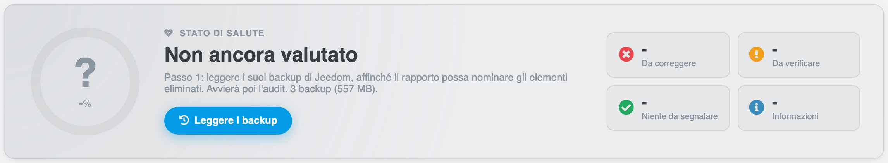
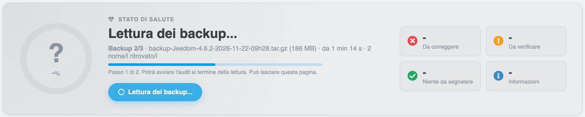
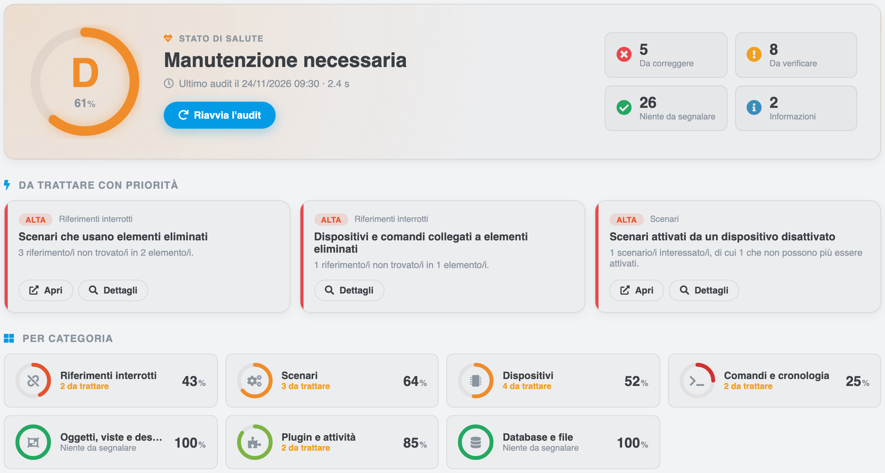
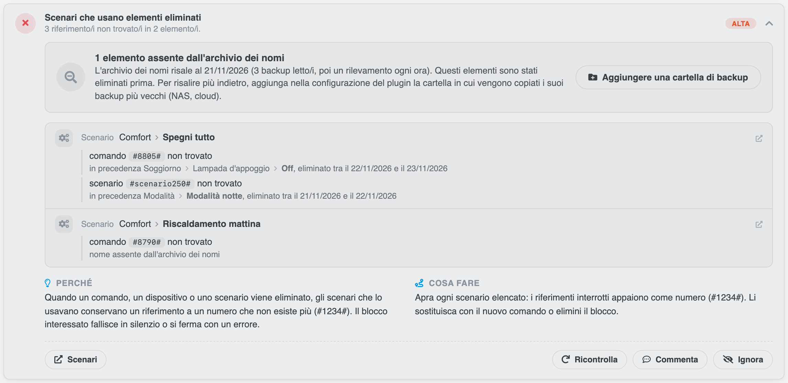
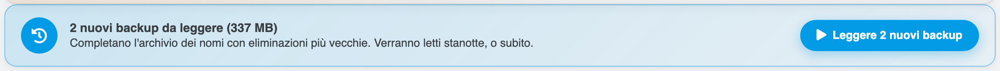
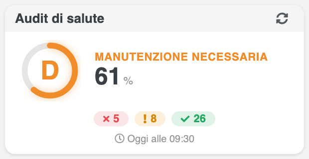

# Plugin Audit Santé

Audit Santé passa al setaccio la sua installazione Jeedom e raccoglie in una sola pagina tutto ciò che serve per verificarla: gli **elementi orfani** (scenari che non si avviano mai, dispositivi che non servono a nulla, variabili inutilizzate...), i **riferimenti interrotti** a elementi eliminati, gli elementi **dimenticati** o **disattivati** e ciò che **ingombra** la box (cronologia, log, messaggi).

Si concentra su ciò che Jeedom non segnala da nessuna parte: uno scenario attivato da un dispositivo disattivato, una vista che mostra un comando eliminato, i dispositivi di un plugin disinstallato, la cronologia di comandi che non esistono più, le attività pianificate di un plugin rimosso...

Ogni problema è elencato con un **link** alla pagina di Jeedom in cui correggerlo. Il plugin assegna anche un punteggio in percentuale, con una lettera da **A** (in piena forma) a **F** (stato critico).

## Installazione

Installi il plugin e lo attivi. Il dispositivo **Audit di salute** viene creato automaticamente. Non serve alcuna dipendenza.

Requisito: Jeedom 4.4 o superiore.

## Avviare un audit

Apra *Plugins > Monitoring > Audit Santé* e clicchi su **Avvia l'audit**. L'audit dura da pochi secondi a un minuto a seconda della dimensione dell'installazione. Non modifica nulla in Jeedom: legge il database e i file di log, e scrive solo i propri file di dati.

**Prima del primo audit**, due passi:

1. **Leggere i backup**: il plugin legge una volta i suoi backup di Jeedom per costruire l'archivio dei nomi (vedi sotto), affinché il rapporto possa nominare gli elementi eliminati. Questa lettura inizia subito dopo l'installazione del plugin, in background; finché non è avvenuta, il pulsante dell'intestazione propone **Leggere i backup**. L'intestazione mostra l'avanzamento; può lasciare la pagina. Senza backup sulla box, termina in pochi secondi. La durata di lettura di ogni backup viene annotata nel log e nel rapporto di diagnostica.
2. **Avviare l'audit**: una volta letti i backup, è lei ad avviare l'audit. Il plugin non lo avvia mai da solo (tranne l'audit automatico, se lo ha impostato nella configurazione).

Il rapporto mostra:

- la **lettera** e il **punteggio** in percentuale;
- **Da trattare con priorità**: i tre problemi più importanti;
- il numero di controlli **Da correggere**, **Da verificare**, **Niente da segnalare**, le **Informazioni** e quelli che ha **Ignorati**;
- un punteggio per categoria: clicchi su una categoria per mostrarne i controlli;
- l'elenco dei controlli. Per impostazione predefinita sono mostrati solo quelli **Da trattare**. Clicchi su un controllo per vedere gli elementi interessati (ognuno è un link alla sua pagina), perché è importante e cosa fare.

## Cosa controlla il plugin

Il plugin legge una sola volta l'intera installazione (oggetti, dispositivi, comandi, scenari con tutti i loro blocchi, interazioni, viste, design, design 3D, riepiloghi, configurazione, utenti) e costruisce l'indice « chi usa cosa ». Riconosce i riferimenti `#1234#` (comando), `#eqLogic12#` (dispositivo), `#scenario5#` e `scenario_id` (scenario), oltre agli elementi posizionati nelle viste e nei design.

### Riferimenti interrotti

| Controllo | Importanza | Cosa viene cercato | Correzione automatica |
|---|---|---|---|
| Scenari che usano elementi eliminati | Alta | Quando un comando, un dispositivo o uno scenario viene eliminato, gli scenari che lo usavano conservano un riferimento a un numero che non esiste più (#1234#). Il blocco interessato fallisce in silenzio o si ferma con un errore. |  |
| Dispositivi e comandi collegati a elementi eliminati | Alta | Virtuali, azioni sul valore, pre e post esecuzione, comandi collegati (stato di un interruttore...): un dispositivo o un comando che punta a un comando eliminato non funziona più correttamente. |  |
| Viste, design e riepiloghi collegati a elementi eliminati | Media | Viste, design, design 3D e riepiloghi degli oggetti conservano gli elementi eliminati: vengono mostrati vuoti o falsano i riepiloghi (temperatura media, numero di luci accese...). |  |
| Interazioni collegate a elementi eliminati | Media | Un'interazione la cui risposta o le cui azioni usano un comando eliminato risponde male o non fa più nulla. |  |
| Configurazione e utenti collegati a comandi eliminati | Media | Comandi di allarme (timeout, batteria, pericolo...), comando di risposta delle interazioni o comando di notifica di un utente: se è stato eliminato, Jeedom non la avvisa più. |  |

### Scenari

| Controllo | Importanza | Cosa viene cercato | Correzione automatica |
|---|---|---|---|
| Scenari in errore | Alta | L'ultimo avvio di questi scenari è terminato con un errore. Potrebbero non fare più ciò che si aspetta senza che lei se ne accorga. |  |
| Scenari attivati da un dispositivo disattivato | Alta | Un dispositivo disattivato non invia più alcun valore: gli scenari che attiva non si avviano più. Jeedom non lo segnala da nessuna parte. |  |
| Scenari attivi che non possono mai avviarsi | Media | Questi scenari sono attivi ma non hanno né attivatore né programmazione, non sono richiamati da nessun altro scenario, dispositivo, interazione, vista o design e non sono mostrati sulla dashboard. Quindi non si avviano mai, salvo a mano o tramite API. |  |
| Scenari che usano elementi disattivati | Media | Questi scenari attivi leggono o comandano un comando di un dispositivo disattivato, oppure avviano uno scenario disattivato: queste azioni non hanno alcun effetto e le condizioni leggono un valore bloccato. |  |
| Scenari che non si avviano più | Bassa | Questi scenari attivi hanno un attivatore o una programmazione, ma non si avviano da molto tempo (o mai). La condizione di attivazione forse non si verifica più: sensore sostituito, modalità eliminata... |  |
| Scenari disattivati dimenticati | Bassa | Scenari disattivati che nessun altro elemento attiva né avvia. Ingombrano l'elenco e possono essere riattivati per errore. |  |
| Scenari vuoti | Bassa | Scenari senza alcun blocco: si avviano per niente o sono stati creati e poi dimenticati. |  |
| Log degli scenari | Bassa | Uno scenario con log in tempo reale o molto prolisso può produrre un file di diverse decine di MB. Anche i log degli scenari eliminati restano sul disco. | Sì |
| Scenari programmati ogni minuto | Info | Uno scenario programmato ogni minuto si avvia 1440 volte al giorno. Spesso un attivatore sul comando sorvegliato fa la stessa cosa senza caricare la box. |  |

### Dispositivi

| Controllo | Importanza | Cosa viene cercato | Correzione automatica |
|---|---|---|---|
| Dispositivi fantasma (plugin rimosso o disattivato) | Alta | Quando un plugin viene rimosso o disattivato, i suoi dispositivi restano nel database: non appaiono più da nessuna parte, ma gli scenari, le viste e i design che li usano non funzionano più. |  |
| Dispositivi in timeout | Media | Questi dispositivi non hanno comunicato entro il ritardo di allarme configurato: batteria scarica, modulo fuori portata, apparecchio scollegato... |  |
| Batterie scariche | Media | Il livello di batteria di questi dispositivi è sotto la soglia di allarme (Impostazioni > Sistema > Configurazione > Dispositivi, o soglia propria del dispositivo). |  |
| Dispositivi muti | Bassa | Dispositivi attivi i cui comandi info non ricevono alcun valore da molto tempo, e senza ritardo di allarme (timeout) configurato: Jeedom quindi non li segnala mai. Spesso sono moduli morti o rimossi dalla casa. |  |
| Dispositivi orfani | Bassa | Dispositivi attivi ma nascosti, nessuno dei cui comandi è storicizzato o usato altrove (scenario, altro dispositivo, interazione, vista, design, riepilogo). A quanto pare non servono a nulla. I comandi usati solo in un blocco codice di uno scenario, tramite il loro nome, non vengono rilevati. |  |
| Dispositivi disattivati | Bassa | Un dispositivo disattivato non invia più nulla ma conserva i suoi comandi, la sua cronologia e i suoi collegamenti. Spesso corrisponde a un apparecchio che non esiste più. |  |
| Dispositivi visibili senza oggetto padre | Bassa | Un dispositivo senza oggetto padre non appare su nessuna dashboard, anche se « Visibile » è spuntato. |  |
| Dispositivi senza comandi | Bassa | Dispositivi che non hanno alcun comando: creazione incompleta, inclusione fallita o residuo di un vecchio apparecchio. |  |

### Comandi e cronologia

| Controllo | Importanza | Cosa viene cercato | Correzione automatica |
|---|---|---|---|
| Comandi senza dispositivo | Media | Comandi il cui dispositivo non esiste più. Invisibili nell'interfaccia, restano nel database con la loro cronologia. | Sì |
| Cronologia di comandi eliminati | Media | Valori storicizzati di comandi che non esistono più. Occupano spazio nel database e rallentano i backup, senza poter essere consultati. | Sì |
| Volume della cronologia | Info | I comandi storicizzati senza pulizia, o che registrano un valore ogni secondo, fanno crescere il database, allungano i backup e rallentano i grafici. |  |
| Comandi inutilizzati | Info | Comandi nascosti, non storicizzati e non usati da nessuna parte (scenario, dispositivo, interazione, vista, design, riepilogo). Non danno fastidio, ma spesso indicano dispositivi da ripulire. |  |
| Comandi senza tipo generico | Info | Il tipo generico indica all'app mobile, agli assistenti vocali e ad alcuni plugin cosa fa un comando (luce, presa, temperatura...). Senza di esso, il comando non vi appare o appare male. |  |

### Oggetti, viste e design

| Controllo | Importanza | Cosa viene cercato | Correzione automatica |
|---|---|---|---|
| Oggetti vuoti | Bassa | Oggetti (stanze) senza dispositivi, senza oggetti figli e senza riepilogo: ingombrano la dashboard e gli elenchi di scelta. |  |
| Viste e design vuoti | Bassa | Viste senza alcun elemento e design senza alcun elemento posizionato: creazione incompleta o residuo di una vecchia organizzazione. |  |
| Widget personalizzati inutilizzati | Bassa | Widget creati in Strumenti > Widget che nessun comando usa. |  |

### Plugin e attività

| Controllo | Importanza | Cosa viene cercato | Correzione automatica |
|---|---|---|---|
| Demoni e dipendenze in errore | Alta | Un plugin il cui demone è fermo o le cui dipendenze non sono installate non comunica più con i suoi dispositivi. |  |
| Attività pianificate in errore | Media | Le attività del motore delle attività (cron del core e dei plugin) in errore non vengono più eseguite correttamente. |  |
| Attività e listener orfani | Media | Attività pianificate e listener che richiamano una classe o una funzione che non esiste più, di solito quella di un plugin rimosso. Girano a vuoto e riempiono i log di errori. | Sì |
| Plugin disattivati | Bassa | Un plugin disattivato resta installato: occupa spazio, appare nel centro aggiornamenti e i suoi dispositivi diventano fantasmi. |  |
| Plugin attivi senza dispositivi | Info | Plugin attivati che non hanno alcun dispositivo. Alcuni plugin funzionano senza dispositivi (strumenti, temi, gateway); gli altri forse sono inutili. |  |
| Residui di plugin rimossi | Bassa | Configurazione e voci del centro aggiornamenti di plugin che non sono più installati. Non disturbano il funzionamento ma riappaiono se il plugin viene reinstallato. |  |

### Database e file

| Controllo | Importanza | Cosa viene cercato | Correzione automatica |
|---|---|---|---|
| Variabili inutilizzate | Bassa | Variabili di scenario che nessuno scenario, dispositivo o interazione legge né scrive. Spesso sono residui di scenari eliminati. Appaiono anche quelle usate solo in un blocco codice o da un programma esterno. |  |
| Variabili di elementi eliminati | Bassa | Variabili collegate a uno scenario o a un dispositivo che non esiste più. | Sì |
| Blocchi di scenari orfani | Bassa | Blocchi, sottoblocchi ed espressioni di scenari non più collegati ad alcuno scenario (residui di eliminazioni o copie interrotte). Occupano il database senza servire. |  |
| Dimensione del database | Info | Le tabelle più voluminose del database di Jeedom. La cronologia ne rappresenta quasi sempre la parte principale. |  |
| File di log voluminosi | Bassa | Un log voluminoso segnala spesso un plugin rimasto in Debug o un errore che si ripete. Consuma la scheda SD e riempie il disco. |  |
| Centro messaggi | Bassa | Decine di messaggi non gestiti sommergono gli avvisi importanti: non si leggono più. |  |

## Calcolo del punteggio

Ogni controllo ha un'importanza, che ne determina il peso nel punteggio:

| Importanza | Peso |
|------------|------|
| Alta       | 10   |
| Media      | 5    |
| Bassa      | 2    |
| Info       | 0    |

Un controllo **Niente da segnalare** ottiene tutti i suoi punti, un controllo **Da verificare** la metà, un controllo **Da correggere** nessuno. Le informazioni e i controlli ignorati non contano.

| Lettera | Punteggio minimo |
|---------|------------------|
| A       | 90               |
| B       | 80               |
| C       | 65               |
| D       | 50               |
| E       | 35               |
| F       | 0                |

## Correggere un problema

A seconda del controllo, il dettaglio propone:

- un **link** su ogni elemento elencato (scenario, dispositivo, vista...), che apre la sua pagina in Jeedom;
- un pulsante di **correzione automatica** (icona della bacchetta magica) solo per i casi senza rischi: eliminare ciò che nulla può più usare (comandi senza dispositivo, cronologia di comandi eliminati, log di scenari eliminati, attività e listener di un plugin rimosso, variabili di elementi eliminati). Una finestra spiega cosa verrà eliminato prima di qualsiasi azione. Faccia prima un backup;
- **Ricontrolla**, per rieseguire solo questo controllo dopo una correzione manuale;
- **Ignora**, se la situazione è voluta (un dispositivo di riserva lasciato disattivato, uno scenario avviato dall'API...). Il controllo esce dal punteggio e resta visibile nel filtro **Ignorati**. Scelga una durata (7 giorni, 30 giorni, 3 mesi, 1 anno o senza limite): al termine, il controllo torna a contare e un messaggio di Jeedom la avvisa. Può annotare il motivo;
- **Commenta**, per conservare una nota sul controllo.

Il plugin non elimina mai uno scenario, un dispositivo o un comando che ha ancora un dispositivo: queste decisioni spettano a lei.

## Ritrovare il nome di un elemento eliminato

Un riferimento interrotto è solo un numero (`#1234#`, `#scenario250#`): l'elemento non esiste più, e nemmeno il suo nome. Il plugin tiene quindi un **archivio dei nomi**:

- **Rilevamento ogni ora**: il nome di ogni comando, dispositivo, oggetto e scenario viene registrato, scrivendo solo ciò che cambia. Quando un elemento scompare, il suo nome è già noto, con l'ora di eliminazione. Non serve alcun backup per ciò che viene eliminato dopo l'installazione del plugin.
- **Backup di Jeedom, letti una sola volta**: per le eliminazioni più vecchie, il plugin legge ogni backup (la copia del database che contiene) una sola volta, in background, senza estrarre nulla sul disco né modificare nulla. I nuovi backup vengono rilevati ogni notte; quelli fatti dopo l'installazione del plugin vengono saltati, il rilevamento orario ne sa di più.
- **Timeline**: nome degli scenari e dei comandi che vi scrivevano.

Il nome ritrovato viene mostrato accanto al riferimento, con il periodo di eliminazione: « comando #999# non trovato (in precedenza [Soggiorno][Lampada][Stato], eliminato tra il 10/11/2026 e il 17/11/2026) ».

La prima lettura dei backup è il passo 1 del primo audit (vedi « Avviare un audit »). In seguito, tutto avviene in un **banner in cima al rapporto**, l'unico punto in cui si agisce sull'archivio:

- **nuovi backup da leggere** (cartella aggiunta, copie più vecchie): pulsante **Leggere i nuovi backup**. Se non fa nulla, vengono letti la notte seguente;
- **lettura in corso**: avanzamento (backup letto, durata, nomi ritrovati). La lettura continua se lascia la pagina; alla fine, il rapporto esistente viene completato con i nomi ritrovati, senza riavviare l'audit;
- **lettura non riuscita**: messaggio di errore e pulsante per rilanciarla;
- niente da leggere: nessun banner.

Nei controlli dei riferimenti interrotti, dei comandi senza dispositivo e della cronologia orfana, un riquadro indica solo se gli elementi senza nome verranno cercati alla prossima scansione, oppure se sono assenti dall'archivio (con la data a cui risale: sono stati eliminati prima).

### Risalire più indietro nel tempo

Per impostazione predefinita, Jeedom conserva i suoi backup sulla box solo per pochi giorni. Se li copia altrove (condivisione NAS, cartella sincronizzata con il cloud), monti quella cartella sulla box e aggiunga il suo percorso in **Cartelle di backup aggiuntive** (configurazione del plugin). I suoi backup verranno letti una volta, la notte seguente o subito dalla pagina del plugin. Un backup presente in due posti viene letto una sola volta; la data viene presa dal nome del file, più affidabile della data di una copia.

## Dove sono memorizzati i dati

Tutti i dati del plugin sono file JSON in `plugins/auditsante/data/`, indipendenti dal database di Jeedom:

| File | Contenuto |
|---|---|
| `report.json` | ultimo rapporto di audit |
| `ignored.json`, `comments.json` | controlli ignorati e commenti |
| `names.json` | archivio dei nomi (una voce per elemento: nome, date di presenza e di eliminazione) |
| `archive-state.json` | backup già letti, date dei rilevamenti, avanzamento della lettura in corso |

La cartella viene conservata durante gli aggiornamenti del plugin, inclusa nei backup di Jeedom e rimossa con il plugin. È protetta contro la lettura dal web. Le scritture sono atomiche: un'interruzione di corrente durante una scrittura lascia intatto il file precedente. Solo le impostazioni della pagina di configurazione restano nella configurazione di Jeedom.

Eliminare uno di questi file non comporta rischi: il rapporto ricompare al prossimo audit, l'archivio al prossimo rilevamento (i backup vengono allora riletti).

## Dispositivo e scenari

Il dispositivo **Audit di salute** porta i seguenti comandi, utilizzabili nei suoi scenari:

| Comando          | Tipo   | Descrizione                                    |
|------------------|--------|------------------------------------------------|
| Punteggio        | info   | Punteggio in percentuale (storicizzato)        |
| Lettera          | info   | Lettera da A a F                               |
| Problemi gravi   | info   | Numero di controlli di importanza alta da correggere |
| Da correggere    | info   | Numero di controlli da correggere              |
| Da verificare    | info   | Numero di controlli da verificare              |
| Ultimo audit     | info   | Data dell'ultimo audit                         |
| Riepilogo        | info   | Riepilogo su una riga                          |
| Avvia l'audit    | action | Riavvia l'audit                                |

Esempio: uno scenario settimanale che le invia il riepilogo, o che la avvisa quando **Problemi gravi** supera 0.

## Configurazione

- **Audit automatico**: ogni giorno, ogni settimana (il lunedì, per impostazione predefinita) o mai.
- **Avvisa dei nuovi problemi**: aggiunge un messaggio nel centro messaggi quando un controllo che non segnalava nulla segnala un problema.
- **Soglie**: ritardo dopo il quale viene segnalato uno scenario che non si avvia più (180 giorni), ritardo dopo il quale viene segnalato un dispositivo muto (30 giorni), dimensione di un log voluminoso (20 MB), numero di messaggi oltre il quale il centro messaggi è sovraccarico (50).
- **Cartelle di backup aggiuntive**: vedi « Risalire più indietro nel tempo ».

## Limiti

- Un comando usato solo in un **blocco codice** di uno scenario, tramite il suo nome (`cmd::byString('#[Soggiorno][Lampada][Stato]#')`), non viene riconosciuto: il dispositivo può apparire come orfano, e una variabile letta in questo modo come inutilizzata.
- Uno scenario avviato solo dall'**API**, da un programma esterno o dall'app mobile appare come « che non può mai avviarsi ». In tal caso ignori il controllo.
- I plugin che memorizzano i loro collegamenti al di fuori della configurazione dei propri dispositivi o comandi non vengono rilevati.
- « Dispositivo muto » si basa sulla data dell'ultimo valore ricevuto, che viene azzerata da un riavvio che svuota la cache.

## FAQ

**L'audit modifica qualcosa?**
No. Solo i pulsanti di correzione automatica modificano il database, e sempre dopo conferma.

**Perché un dispositivo che uso è segnalato come orfano?**
È nascosto, nessuno dei suoi comandi è storicizzato e il plugin non trova alcun riferimento ad esso (vedi i limiti sopra). Ignori il controllo o renda visibile il dispositivo.

**Segnalare un problema**
Imposti il log del plugin su Debug, riavvii l'audit, poi clicchi su **Diagnostica** nella pagina del plugin e alleghi il file al suo messaggio sul forum (indirizzi pubblici, account ed e-mail vi sono mascherati).
